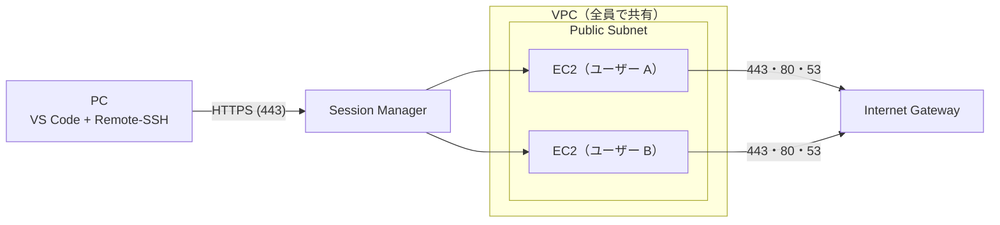

# EC2 Workstation

EC2 の上に、ユーザーごとの Linux の開発環境を OpenTofu で作ります。
VS Code の Remote-SSH から、Session Manager を通して接続します。

- 22 番ポートを開けません。SSH は Session Manager の上を通り、IAM で認証します。
- `workstation-config.json` に並べたユーザーごとに、EC2 を 1 台ずつ作ります。
- Docker が入っているので、Dev Containers が使えます。

## 1. 前提

### ツール

| 使う人 | ツール | 版 |
|--------|--------|----|
| デプロイする人 | bash・jq・curl・tar | — |
| | AWS CLI | v2 |
| | OpenTofu | 1.10 以上。`./scripts/install/install-tofu.sh` で CI と同じ版を `.tools/tofu-<版>/` に取れます（PATH に足して使います） |
| | jv | `./scripts/install/install-jv.sh` で入れます。スクリプトはこれで入れた jv しか使いません |
| 接続する人 | AWS CLI | v2 |
| | Session Manager Plugin | — |
| | VS Code と Remote - SSH 拡張機能 | — |
| | Windows PowerShell（Windows のとき） | 5.1 以上 |

道具の版は `scripts/lib/tools.sh` で固定しています。

### 権限

- デプロイする主体には、CodePipeline の apply のロールと同じ権限が要ります。[cloudformation/codepipeline.yaml](cloudformation/codepipeline.yaml) の `StatePolicy`・`ReadPolicy`・`WritePolicy` です。Deny の文も含めてそろえます。
- state のバケットを `SSE-KMS-CMK` にしたときは、state を読み書きする全員に、その鍵の `kms:Decrypt`・`kms:GenerateDataKey` が要ります。
- 接続する人の権限は、[5. 接続](#5-接続) にあります。

## 2. AWS の準備

初回だけ、次の順に作ります。

1. state のバケット
2. permissions boundary
3. CodePipeline か GitHub Actions（使うときだけ）

### 2.1 state のバケット

[cloudformation/state-bucket.yaml](cloudformation/state-bucket.yaml) で、OpenTofu の state を置く S3 バケットを作ります。
アカウントに 1 つ作り、environment をまたいで使います。
リージョンは `ap-northeast-1` だけです（スクリプトが state を探すリージョンです）。

```bash
aws cloudformation deploy --region ap-northeast-1 \
  --template-file cloudformation/state-bucket.yaml \
  --stack-name ec2-workstation-tofu-state

aws cloudformation describe-stacks --region ap-northeast-1 --stack-name ec2-workstation-tofu-state \
  --query "Stacks[0].Outputs" --output table
```

| パラメータ | 既定 | 中身 |
|-----------|------|------|
| `BucketName` | 空（`ec2-workstation-tofu-state-<account-id>`） | 小文字・数字・ハイフンで 3〜63 字。ドットは使えません |
| `Encryption` | `SSE-S3` | `SSE-S3`・`SSE-KMS-AWS-MANAGED`・`SSE-KMS-CMK` |

| 出力 | 渡す先 |
|------|--------|
| `BucketName` | 環境変数 `TF_STATE_BUCKET`、CodePipeline の `StateBucketName`、GitHub の secret `TF_STATE_BUCKET` |
| `StateKmsKeyArn`（`SSE-KMS-CMK` のときだけ） | CodePipeline の `StateKmsKeyArn` |

- state には SSH の秘密鍵が平文で入ります。守りを強めるなら `SSE-KMS-CMK` を選びます。
- `SSE-KMS-CMK` を選んだら、後から方式を変えないでください。古い state は、その鍵で暗号化されたまま残ります。
- スタックを消しても、バケットと鍵は残ります。
- ほかのリージョンで作ると失敗し、空のスタックが `ROLLBACK_COMPLETE` で残ります。`aws cloudformation delete-stack --region <リージョン> --stack-name <スタック名>` で消します。

### 2.2 permissions boundary

[cloudformation/permissions-boundary.yaml](cloudformation/permissions-boundary.yaml) で、モジュールが作る IAM のロールの上限を作ります。
無いまま deploy すると、ロールを作る所で止まります。
`projectName` と `environment` の組ごとに 1 つ作ります。
IAM のポリシーなので、スタックはどのリージョンに作っても同じです。

```bash
aws cloudformation deploy \
  --template-file cloudformation/permissions-boundary.yaml \
  --stack-name <projectName>-<environment>-permissions-boundary \
  --capabilities CAPABILITY_NAMED_IAM \
  --parameter-overrides ProjectName=<projectName> Environment=<environment>
```

| パラメータ | 中身 |
|-----------|------|
| `ProjectName` | `workstation-config.json` の `projectName` |
| `Environment` | `workstation-config.json` の `environment` |

ポリシーの名前は `<projectName>-<environment>-permissions-boundary` です。
出力 `PermissionsBoundaryArn` は、どこにも渡しません。OpenTofu が名前から同じ ARN を作ります。

### 2.3 deploy の道を選ぶ

| 道 | 向く場合 | 要るもの |
|----|----------|----------|
| 手元 | 管理者が手元から回す | [1. 前提](#1-前提) のツールと権限 |
| GitHub Actions | リポジトリが GitHub にある | [2.5](#25-github-actions) のロールと secrets |
| CodePipeline | GitHub を使わず、AWS の中だけで回す。apply の前に承認を挟む | [2.4](#24-codepipeline) のスタック |

どの道も、中身は同じ `scripts/tofu-deploy.sh` です。
deploy と destroy を同時に走らせないでください。state が network と workstations に分かれていて、ロックは片方ずつにしか効きません。

### 2.4 CodePipeline

[cloudformation/codepipeline.yaml](cloudformation/codepipeline.yaml) で、CodeCommit のリポジトリとパイプラインを作ります。
スタックを作ったリージョンに、CodeCommit とパイプラインができます。

```bash
aws cloudformation deploy \
  --template-file cloudformation/codepipeline.yaml \
  --stack-name ec2-workstation-pipeline \
  --capabilities CAPABILITY_NAMED_IAM \
  --parameter-overrides \
    StateBucketName=<state のバケット> ProjectName=<projectName> Environment=<environment> DeployRegion=<awsRegion>
```

| パラメータ | 既定 | 中身 |
|-----------|------|------|
| `StateBucketName` | — | state のスタックの出力 `BucketName` |
| `StateKmsKeyArn` | 空 | state のスタックの出力 `StateKmsKeyArn`（`SSE-KMS-CMK` のときだけ）。ap-northeast-1 の鍵の ARN で、エイリアスは使えません |
| `ProjectName` | — | `workstation-config.json` の `projectName` |
| `Environment` | — | `workstation-config.json` の `environment` |
| `DeployRegion` | — | `workstation-config.json` の `awsRegion` |
| `RepositoryName` | `ec2-workstation` | 作る CodeCommit のリポジトリの名前 |
| `BranchName` | `develop` | このブランチへの push でパイプラインが始まります |
| `ApprovalTopicArn` | 空 | 承認を知らせる SNS のトピック。空なら知らせません |

- `ProjectName`・`Environment` が設定と違うと、権限が足りずに止まります。
- スタック名を `<projectName>-<environment>-` で始めないでください。パイプラインのロールの名前が、apply のロールが扱う名前の前置きに当たります。
- `StateKmsKeyArn` を空のまま `SSE-KMS-CMK` のバケットを使うと、plan の段が AccessDenied で止まります。

スタックができたら、このリポジトリを push します。
push 先は、出力 `RepositoryCloneUrlGrc`（git-remote-codecommit）か `RepositoryCloneUrlHttp`（HTTPS）です。

```bash
pip install git-remote-codecommit
git remote add codecommit <RepositoryCloneUrlGrc の値>
git push codecommit develop
```

パイプラインの段:

| 段 | 中身 |
|----|------|
| Check | `just ci`。落ちたら plan に進みません |
| NetworkPlan | network の plan |
| NetworkApprove・NetworkApply | network に変更があるときだけ、承認してから保存した plan を apply します |
| UsersPlan | 全員の plan と、設定から消えた人の destroy の plan |
| Approve・Apply | 変更があるときだけ、全員分を 1 回で承認してから apply します |

承認するとき:

- 承認の画面の文は `commit / build / removed / replace / delete / create / update` の順です。作り直すアドレスの全部は、その plan の CodeBuild のログにあります。
- 要約だけでなく、コミットの差分も見てください。apply の段もリポジトリのスクリプトを走らせます。
- 承認は 7 日で期限が切れます。切れたら流し直します。
- apply が止まったら、原因を直してから **Release change** で流し直します。**Retry** は古い plan を使うので、必ず止まります。
- 承認を待つ間に push した実行は、apply の段で「plan が古い」で止まります。前の実行が終わってから **Release change** で流し直します。

plan のファイルには、state と同じく秘密鍵が入ります。アーティファクトのバケットは、スタックが作る KMS の鍵で暗号化します。

### 2.5 GitHub Actions

Actions の画面から **Deploy (OpenTofu)** を手で走らせます。
**Destroy (OpenTofu)** は、確認の欄に `destroy` と入れて走らせます。

リポジトリの secrets を 2 つ登録します。

| secret | 中身 |
|--------|------|
| `AWS_DEPLOY_ROLE_ARN` | deploy に使う IAM のロールの ARN |
| `TF_STATE_BUCKET` | state のスタックの出力 `BucketName` |

`AWS_DEPLOY_ROLE_ARN` のロールは、自分で作ります。

- GitHub の OIDC（`token.actions.githubusercontent.com`）で、このリポジトリから引き受けられるようにします。
- 権限は、CodePipeline の apply のロールと同じにします（[1. 前提](#権限)）。

## 3. 設定

`workstation-config.json` に、プロジェクトとユーザーを書きます。

```json
{
  "$schema": "./workstation-config.schema.json",
  "projectName": "ec2-workstation",
  "environment": "dev",
  "awsRegion": "ap-northeast-1",
  "vpcCidr": "10.0.0.0/16",
  "defaultInstanceConfig": {
    "os": "al2023",
    "instanceType": "t3.medium",
    "rootVolumeSize": 30,
    "rootVolumeType": "gp3",
    "dataVolumeSize": 40,
    "dataVolumeType": "gp3"
  },
  "autoStopConfig": {
    "cpuThreshold": 3,
    "cpuEvaluationMinutes": 30,
    "scheduledStopHour": 23,
    "scheduledStopMinute": 0
  },
  "enableElasticIp": false,
  "users": [
    { "username": "developer1", "displayName": "Developer One" },
    {
      "username": "developer2",
      "displayName": "Developer Two",
      "instanceConfig": { "os": "ubuntu-24.04", "instanceType": "t3.xlarge", "dataVolumeSize": 200 },
      "enableElasticIp": true
    }
  ]
}
```

| 項目 | 中身 |
|------|------|
| `projectName` | リソースの名前の前置き |
| `environment` | `dev`・`staging`・`prod` |
| `awsRegion` | VPC とインスタンスを作るリージョン |
| `vpcCidr` | VPC の CIDR |
| `defaultInstanceConfig.os` | OS（下の表） |
| `defaultInstanceConfig.instanceType` | インスタンスタイプ（x86_64 だけ） |
| `defaultInstanceConfig.rootVolumeSize`・`rootVolumeType` | ルートボリュームの GB と種類 |
| `defaultInstanceConfig.dataVolumeSize`・`dataVolumeType` | データボリュームの GB と種類 |
| `autoStopConfig.cpuThreshold` | 自動停止する CPU 使用率（%）の閾値 |
| `autoStopConfig.cpuEvaluationMinutes` | 閾値を下回り続けたら止める分数 |
| `autoStopConfig.scheduledStopHour`・`scheduledStopMinute` | 毎日止める時刻（JST） |
| `enableElasticIp` | Elastic IP を付けるか |
| `users[].username` | ユーザー名 |
| `users[].displayName` | 表示名（省略可） |
| `users[].instanceConfig` | `defaultInstanceConfig` の項目をユーザーごとに上書きします（省略可） |
| `users[].enableElasticIp` | `enableElasticIp` をユーザーごとに上書きします（省略可） |

仕様（必須・範囲・書き方）は [workstation-config.schema.json](workstation-config.schema.json) にあります。
`scripts/tofu-deploy.sh`・`scripts/tofu-init.sh` は、スキーマに合わない設定では何もせずに止まります。
`just validate-config` でも確かめられます。

後から変えるときの注意:

- `projectName` を変えると、全部のリソースが作り直されます。
- `awsRegion` を変えると、前のリージョンの環境を見失います。先に `scripts/tofu-destroy.sh` で消します。
- `os` を変えると、インスタンスが作り直されます。データボリュームは残ります。ログインユーザーが変わるなら、`setup-remote-ssh` をやり直します。

### OS

| `os` | OS | ログインユーザー |
|------|----|-----------------|
| `al2023` | Amazon Linux 2023 | `ec2-user` |
| `al2027-preview` | Amazon Linux 2027（プレビュー） | `ec2-user` |
| `ubuntu-24.04` | Ubuntu 24.04 LTS | `ubuntu` |
| `ubuntu-26.04` | Ubuntu 26.04 LTS | `ubuntu` |
| `debian-13` | Debian 13 | `admin` |

- `al2027-preview` は、AWS がプレビューの AMI のパラメータを消すと、全員の plan が失敗します。そのときは `os` を変えます。
- `al2027-preview`・`debian-13`・`ubuntu-26.04` で作ったデータボリュームを `al2023` で使うと、user-data がマウントの前に止まります。いったん `al2027-preview` で apply し、user-data が走り切ってから `os` を戻します。

## 4. デプロイ

```bash
export TF_STATE_BUCKET=<state のバケット>
./scripts/tofu-deploy.sh
```

`scripts/tofu-deploy.sh` は次のことをします。

1. network（VPC・サブネットなど、全員で使うもの）を plan して apply します。
2. 設定にいる全員の plan と、設定から消えた人の destroy の plan を取ります。
3. 2 の plan が全部通ったら apply し、消えた人の state を消します。1 つでも失敗したら、誰も apply しません。

端末で走らせると、変更のある段ごとに plan の要約を出し、`yes` を待ちます。
`yes` 以外なら、何も apply せずに終わります（終了コード 1）。
端末でないとき（CI）は、確かめずに進みます。

次のときは、apply せずに止まります。

- `workstation-config.json` がスキーマに合わない。
- VPC・サブネットを作り直す・消す変更がある（`vpcCidr` を変えたなど）。`scripts/tofu-destroy.sh` で全部を消してから、デプロイし直します。

差分だけを見るとき、1 人分だけを apply するとき:

```bash
./scripts/tofu-init.sh network && tofu -chdir=opentofu/stacks/network plan

./scripts/tofu-init.sh workstations <username> && tofu -chdir=opentofu/stacks/workstations plan
./scripts/tofu-init.sh workstations <username> && tofu -chdir=opentofu/stacks/workstations apply
```

- `tofu-init.sh workstations <username>` は、その人の state（workspace）を選びます。
- 1 人分の apply は、ほかの人のインスタンスに触れません。設定から消えた人の destroy もしません。
- 出力は `tofu -chdir=opentofu/stacks/workstations output workstations` で見ます。

リージョンは 2 つあります。

- state のバケット: `ap-northeast-1` 固定（`scripts/lib/tofu-common.sh` の `STATE_REGION`）
- VPC とインスタンス: `awsRegion`

## 5. 接続

### 接続する人の権限

| 操作 | 使う所 |
|------|--------|
| `ec2:DescribeInstances` | Name タグからインスタンスを引く、状態を見る |
| `ec2:StartInstances` | 止まっているインスタンスを起動する |
| `ec2:DescribeKeyPairs` | キーペアの ID を引く（setup） |
| `ssm:GetParameter`（`/ec2/keypair/*`） | 秘密鍵を取る（setup） |
| `ssm:DescribeInstanceInformation` | SSM Agent が通るまで待つ |
| `ssm:StartSession` | 接続する |

### Name タグ

接続先は、インスタンスの Name タグで指します。
Name タグは `<projectName>-<environment>-<username>-instance` です（例: `ec2-workstation-dev-developer1-instance`）。
インスタンスを作り直しても変わりません。

### セットアップ

Windows:

```powershell
powershell -NoProfile -ExecutionPolicy Bypass -File .\scripts\client\setup-remote-ssh.ps1
```

この形は、実行ポリシーを変えずに、このプロセスだけでスクリプトを許します。
グループポリシーで実行ポリシーが決まっている PC では効きません。

mac・Linux:

```bash
./scripts/client/setup-remote-ssh.sh
```

聞かれること:

| 項目 | 既定 |
|------|------|
| Name タグ | — |
| SSH のホスト名 | `ec2` |
| リージョン | `ap-northeast-1`。`awsRegion` と違うなら、`awsRegion` を入れます |

スクリプトがすること:

- 秘密鍵を SSM Parameter Store から取り、`~/.ssh/` に置きます。
- ログインユーザーを、インスタンスの `LoginUser` タグから取ります。
- 接続用のスクリプトを `~/.ssh/ec2-workstation-proxy-<ホスト名>.ps1`（`.sh`）に置きます。
- `~/.ssh/config` に、そのスクリプトを ProxyCommand にしたホストを足します。

接続用のスクリプトを新しい版にするときは、そのホストの setup をやり直します。

### VS Code

1. `Ctrl + Shift + P` → `Remote-SSH: Connect to Host...` を選びます。
2. 設定したホスト名（例: `ec2`）を選びます。
3. プラットフォームを聞かれたら、**Linux** を選びます。

## 6. 日々の使い方

### 起動

接続すると、止まっているインスタンスを起動し、SSM Agent が通るまで最長 5 分待ちます。
接続の前に起動しておくときは、次を走らせます。

```powershell
powershell -NoProfile -ExecutionPolicy Bypass -File .\scripts\client\start-ec2.ps1
```

```bash
./scripts/client/start-ec2.sh
```

### 停止

次のどちらかで、自動で止まります。

- CPU 使用率が `cpuThreshold` 未満のまま `cpuEvaluationMinutes` 分たったとき（CloudWatch Alarm）
- 毎日 `scheduledStopHour`:`scheduledStopMinute`（JST）（EventBridge Scheduler）

### AMI の更新とデータボリューム

apply のたびに、その OS の最新の AMI を引きます。
新しい AMI があれば、インスタンスを作り直します。
作業データはデータボリュームに置くので、作り直しても残ります。

| 場所 | 置き場所 | 作り直した後 |
|------|----------|--------------|
| `~/work` | データボリューム | 残ります |
| Docker のイメージ・コンテナ・ボリューム | データボリューム | 残ります |
| `~/.gitconfig` | データボリューム | 残ります |
| そのほか（dotfiles、パッケージなど） | ルートボリューム | 消えます |

- user-data（[user-data.sh.tftpl](opentofu/modules/workstation/templates/user-data.sh.tftpl)）が変わったときも、インスタンスを作り直します。
- 起動中のインスタンスも、apply で止めてから作り直します。
- `scripts/tofu-deploy.sh` は全員を plan します。新しい AMI があれば、どの目的の deploy でも全員を作り直します。自分の分だけなら、[4. デプロイ](#4-デプロイ) の 1 人分の apply を使います。
- Docker のイメージは、OS の系統（Amazon Linux と Ubuntu・Debian）ごとに置き場所が違います。系統を変えると、戻すまで見えません。
- `dataVolumeSize` を増やすと、ボリュームはその場で大きくなります。ファイルシステムは作り直すまで広がらないので、すぐ使うなら `sudo resize2fs "$(findmnt -n -o SOURCE /data)"` を走らせます。
- `dataVolumeSize` は減らせません。apply で AWS が断ります。

### 困ったとき

データボリュームが付かずに起動したとき、`~/work` は書き込めなくなります。
インスタンスを作り直します。

```bash
./scripts/tofu-init.sh workstations <username>
tofu -chdir=opentofu/stacks/workstations apply -replace='module.workstation["<username>"].aws_instance.this'
```

SSM で入れないときは、user-data のログをシリアルコンソールの出力で読みます。

```bash
aws ec2 get-console-output --instance-id <instance-id> --latest --output text
```

user-data が走らなかったとき（`/var/log/user-data.log` が無い）は、インスタンスの中で手で走らせます。
user-data が fstab の所で ERROR を出して止まったときも、`/etc/fstab` を直してから同じように走らせます。

```bash
TOKEN=$(curl -fsS -X PUT http://169.254.169.254/latest/api/token -H "X-aws-ec2-metadata-token-ttl-seconds: 300")
curl -fsS -H "X-aws-ec2-metadata-token: $TOKEN" http://169.254.169.254/latest/user-data | gunzip > ~/user-data.sh
sudo bash ~/user-data.sh
```

一度走り切った後の再実行は想定していません。

### user-data にツールを足す

ルートに入れたツールを作り直しの後も残すには、[user-data.sh.tftpl](opentofu/modules/workstation/templates/user-data.sh.tftpl) に足します。
このファイルは OpenTofu の `templatefile` で展開します。

- `${VAR}` は `$${VAR}` と書きます。`$VAR` はそのまま書けます。
- `%{` は `%%{` と書きます。
- テンプレートに渡す値は `data_volume_id`・`username`・`login_user` の 3 つです。

## 7. ユーザーの追加と削除・全部の削除

### ユーザーの追加と削除

`workstation-config.json` の `users` を直して、デプロイします。
消した人のリソースと state は、次のデプロイで消えます。

> [!WARNING]
> ユーザーを消すと、データボリュームも消えます。スナップショットは残しません。残したいデータは先に退避してください。

### 全部の削除

次の順に消します。

1. `./scripts/tofu-destroy.sh` で、state を持つ全員の workstations と network を消します。端末なら段ごとに要約を出し、`yes` を待ちます。設定は検証しません。
2. CodePipeline を使ったなら、そのスタックを消します。
3. boundary のスタックを消します。
4. state のスタックを消します。バケットと鍵は残るので、要らなければ手で消します。

`scripts/tofu-destroy.sh` は、全員のデータボリュームを消します。データは取り戻せません。

CodePipeline のスタックは、アーティファクトのバケットを空にしてから消します。

```bash
bucket=$(aws cloudformation describe-stack-resource --stack-name <スタック名> --logical-resource-id ArtifactBucket --query StackResourceDetail.PhysicalResourceId --output text)
aws s3 rm "s3://$bucket" --recursive
aws cloudformation delete-stack --stack-name <スタック名>
```

- KMS の鍵は、7 日後に消えます。
- CodeCommit のリポジトリは残ります。

## 8. 構成



ユーザーごとに、EC2・データボリューム・セキュリティグループ・IAM ロール・キーペア・自動停止を作ります。
VPC・サブネット・Internet Gateway は、全員で 1 つです。

設計の理由:

- Public Subnet: NAT Gateway の費用をかけないためです。インバウンドはセキュリティグループで全部閉じます。
- VPC の共有: VPC は全員で同じでよく、分けるのは EC2 から下で足ります。

守り:

- インバウンドは全部拒みます。アウトバウンドは 443・80・53 だけです。
- IMDSv2 を強制します。
- EBS を暗号化します。
- VPC Flow Logs が、拒んだ通信を CloudWatch Logs に 30 日残します。
- 接続（StartSession）は CloudTrail の Event history に 90 日残ります。セッションの中の操作は記録しません。

user-data が入れるもの:

| 種類 | ソフトウェア |
|------|-------------|
| コンテナ | Docker、Docker Compose、buildx |
| AWS | AWS CLI v2 |
| 開発ツール | Git、vim、nano、curl、wget（Amazon Linux を除く）、jq、tree、htop、uuidgen |
| ビルド | build-essential（Amazon Linux は gcc・gcc-c++・make） |
| 設定 | 4GB のスワップ、タイムゾーン Asia/Tokyo |

## 9. コスト

次のものに料金がかかります。

| もの | かかるとき |
|------|------------|
| EC2 | 動いている間 |
| EBS（ルートとデータ） | 止めている間も |
| Elastic IP | 有効にした人。止めている間も |
| データ転送 | インターネットへ出る分 |
| VPC Flow Logs・CloudWatch Logs | 拒んだ通信の記録 |
| KMS の鍵 | `SSE-KMS-CMK` の state、CodePipeline のアーティファクト |
| CodePipeline・CodeBuild | CodePipeline を使うとき |

## 10. 開発

| パス | 中身 |
|------|------|
| `opentofu/` | OpenTofu のモジュールと stack（[opentofu/README.md](opentofu/README.md)） |
| `cloudformation/` | state のバケット、permissions boundary、CodePipeline のテンプレートと buildspec |
| `scripts/` | deploy・destroy のスクリプト、道具の取り込み（`install/`）、テスト（`tests/`） |
| `scripts/client/` | 利用者の PC で走らせるスクリプト |
| `schemas/` | スキーマの書き間違いを断る draft-07 のメタスキーマ |
| `workstation-config.json`・`.schema.json` | 設定とそのスキーマ |

```bash
just ci
```

- `just ci` は GitHub Actions の CI と同じ検査を走らせます。
- 検査の道具は `scripts/install/` で `.tools/` に入れます。
- Windows PowerShell 5.1 での検査は、GitHub Actions だけが行います。
