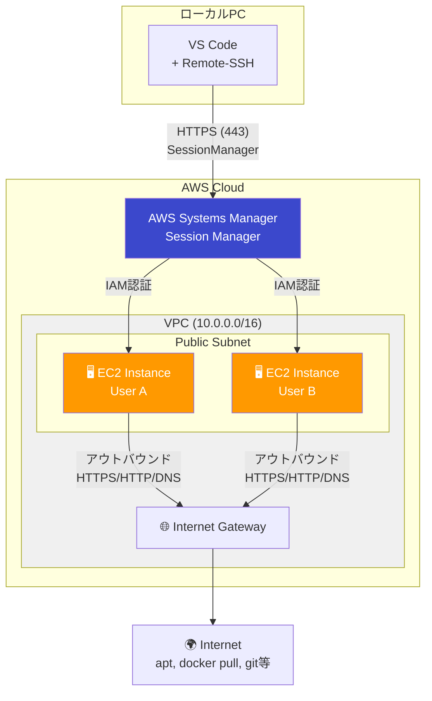
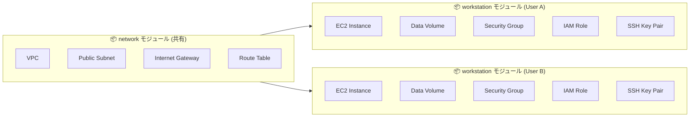
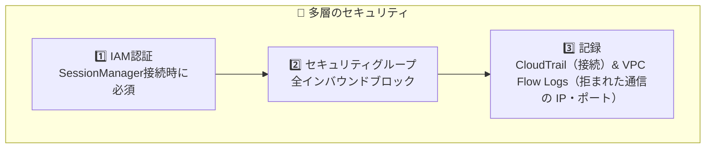
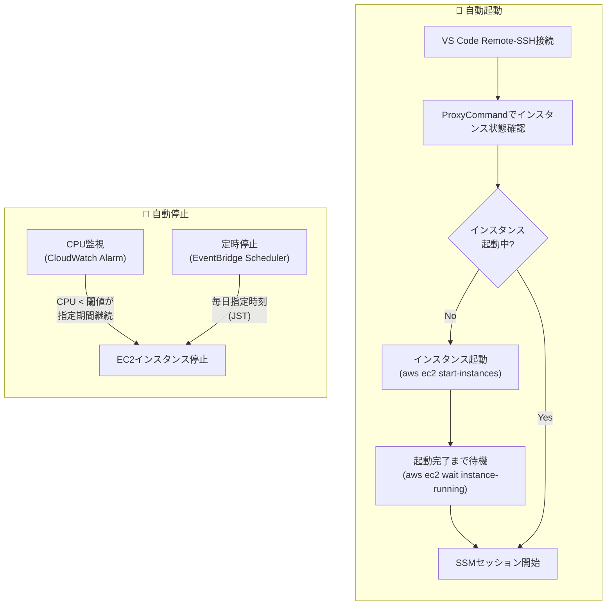

# EC2 Workstation

OpenTofu を使用して、EC2上にセキュアなLinux開発環境を構築するプロジェクトです。

## 📋 プロジェクト概要

### 主な特徴

- **SessionManager経由のセキュアな接続** - SSH(22)ポートを開放せず、IAM認証でセキュアにアクセス
- **チーム開発対応** - 設定ファイル（`workstation-config.json`）でユーザーを定義し、各メンバーに独立したEC2環境を提供
- **DevContainer対応** - Docker環境がプリインストールされており、VS Code DevContainerでの開発が可能
- **Infrastructure as Code** - OpenTofu による再現可能なインフラ構築

### 想定ユースケース

| ケース | 説明 |
|--------|------|
| **ローカルPCに制限がある場合** | 管理者権限なし、WSL使用不可、社内ポリシーでの制限など |
| **チーム開発環境の統一** | 全メンバーが同一構成の開発環境を使用 |
| **セキュアなリモート開発** | 22 番ポートを開けない（SSH は Session Manager の上を通る）、IAM 認証、接続の記録は CloudTrail |
| **高スペックな開発環境が必要** | ローカルPCよりもパワフルなEC2インスタンスを使用 |

---

## 🏗️ アーキテクチャ



### リソース構成



---

## 🔧 技術スタック

| カテゴリ | 技術 | 説明 |
|---------|------|------|
| IaC | OpenTofu | 宣言的なインフラ構築 |
| OS | Amazon Linux 2023 / 2027（プレビュー）/ Ubuntu 24.04・26.04 LTS / Debian 13 | `workstation-config.json` の `os` で選択（ユーザー単位で上書き可、x86_64 のみ） |
| インスタンス | EC2（タイプは `workstation-config.json` で指定） | ユーザー単位で上書き可（例: t3.medium = 2vCPU / 4GB RAM） |
| ストレージ | EBS gp3 / gp2（ルート + データの 2 本。サイズ・タイプは `workstation-config.json` で指定） | 暗号化有効、データボリュームは AMI 更新後も残る |
| 接続方式 | SSM SessionManager | SSH不要、IAM認証 |

### Public Subnet採用について

一般的にはPrivate Subnet + NAT Gatewayがベストプラクティスですが、本プロジェクトでは**Public Subnet**を採用しています。

| 項目 | 説明 |
|------|------|
| **コスト削減** | NAT Gateway ($45/月) + VPC Endpoints ($30/月) = **月$75削減** |
| **セキュリティ担保** | セキュリティグループで**全インバウンドをブロック**（SSHポート含む）<br/>アウトバウンド：HTTPS(443)、HTTP(80)、DNS(53)のみ許可 |
| **IAM認証** | SessionManager接続にはIAM認証が必須 |
| **接続の記録** | Session Manager の接続（StartSession）は CloudTrail の Event history に 90 日残る（誰が・いつ・どのインスタンスへ）。セッションの中の操作は記録しない（記録の設定（Session Manager の preferences）をしていない。VS Code の SSH 接続は、AWS の仕様でも記録の対象外） |

> ⚠️ パブリックIPが付与されますが、セキュリティグループで全インバウンドをブロックするため、外部から直接接続することはできません。

### VPC/Subnet共有設計

VPCとSubnetはチームメンバー間で共有し、EC2インスタンスのみ個人ごとに分離します。

| リソース | 共有/分離 | 理由 |
|----------|----------|------|
| VPC | 共有 | コスト削減、管理容易 |
| Public Subnet | 共有 | 個別作成の必要なし |
| EC2インスタンス | **分離** | 完全に独立した開発環境 |
| セキュリティグループ | **分離** | インスタンスごとの通信制御 |
| IAMロール | **分離** | 最小権限の原則 |

### セキュリティ



| セキュリティ層 | 説明 |
|---------------|------|
| **IAM認証** | SessionManager接続にはAWS認証情報が必要 |
| **セキュリティグループ** | インバウンド：全拒否、アウトバウンド：HTTPS(443)、HTTP(80)、DNS(53)のみ許可 |
| **VPC Flow Logs** | 拒否されたトラフィックをCloudWatch Logsに記録（セキュリティ監査用、保持期間：1ヶ月） |
| **接続の記録** | StartSession が CloudTrail の Event history に 90 日残る。90 日より長く残すには、アカウントに trail か event data store を作る。セッションの中の操作は記録しない（記録の設定をしていない。VS Code の SSH 接続は、AWS の仕様でも記録の対象外） |
| **EBS暗号化** | 全ボリュームをAWS管理キーで暗号化 |
| **IMDSv2強制** | インスタンスメタデータサービスv2を強制（SSRF対策） |
| **リソースタグ** | `Owner`タグでリソースを識別（管理・フィルタリング用） |

### 自動起動・自動停止

コスト削減のため、EC2インスタンスの自動起動・自動停止機能を提供しています。



| 機能 | 方式 | 説明 |
|------|------|------|
| **自動起動** | ProxyCommand | SSH接続時にインスタンスが停止中なら自動起動し、起動完了まで待機 |
| **CPU監視停止** | CloudWatch Alarm | CPU使用率が閾値未満の状態が指定期間続くと自動停止（設定可能） |
| **定時停止** | EventBridge Scheduler | 毎日指定時刻（JST）に自動停止（設定可能） |

> 💡 **コスト削減効果**: 使用していない時間帯のEC2料金を削減できます。インスタンスが停止中でもEBS料金は発生しますが、EC2の時間課金は発生しません。
>
> ⚙️ **設定変更**: `workstation-config.json` の `autoStopConfig` で CPU閾値、監視期間、定時停止時刻をカスタマイズできます。

### AMI の自動更新とデータボリューム

`tofu apply` のたびに最新の AMI を参照し、新しい AMI が公開されていればインスタンスを作り直します（OS・パッケージを AMI 単位で更新する）。作業データはインスタンスと独立した**データボリューム**に置くため、作り直し後もそのまま残ります。

| 場所 | 置き場所 | AMI 更新後 |
|------|---------|-----------|
| `~/work` | データボリューム（`/data/work` を bind mount） | 残る |
| Docker のイメージ・コンテナ・ボリューム | データボリューム（`/var/lib/docker`・`/var/lib/containerd` を bind mount） | 残る。`os` を変えたときも、名前付きボリュームは引き継がれる。イメージは、別の系統の OS（Ubuntu・Debian ↔ Amazon Linux）にいる間は見えず、戻せば見える（Docker の系統でイメージの置き場所が違うため。見えない間は devcontainer を開き直して build し直す） |
| `~/.gitconfig` | データボリューム（`/data/git/config` へのシンボリックリンク） | 残る |
| 上記以外（dotfiles、apt で入れたパッケージなど） | ルートボリューム | **消える** |

- AMI が同じでも、user-data（[user-data.sh.tftpl](opentofu/modules/workstation/templates/user-data.sh.tftpl)）が変わった `apply` ではインスタンスが作り直されます（cloud-init は同じインスタンスでは user-data を走らせ直さないため）。user-data は gzip して渡すので、`tofu plan` やコンソールでは中身が読めません。何が変わったかは git の差分で確かめてください
- 作り直しの流れ: 旧インスタンスを停止 → データボリュームをデタッチ → 旧インスタンス削除 → 新インスタンス作成 → データボリュームをアタッチ → user-data がマウント
- 起動中のインスタンスも `apply` で停止されます。新しい AMI があるかは、その人の workstations の plan（[4. デプロイ](#4-デプロイ) の「差分だけ見る」）で `aws_instance` が `-/+` になるかで確認できます
- 新しい AMI が出ていれば、`scripts/tofu-deploy.sh` は全員分を plan するので、ユーザーの追加など**どの目的の deploy でも全員のインスタンスが作り直されます**（端末なら、作り直す人の一覧を出して `yes` を待ちます）。自分の分だけを作り直すときは、[4. デプロイ](#4-デプロイ) の「1 人分だけ apply する」の手順を使います。state はユーザーごとに分かれているので、1 人分の apply はほかの人のインスタンスに触れません
- インスタンス ID は作り直しのたびに変わります。接続スクリプトは Name タグでインスタンスを探すため、インスタンスの作り直しでは `setup-remote-ssh` のやり直しは不要です（接続用のスクリプトを新しい版にするときは、そのホストの `setup-remote-ssh` をやり直します）
- ルートに入れたツールを残したい場合は [user-data.sh.tftpl](opentofu/modules/workstation/templates/user-data.sh.tftpl) に追加してください。このファイルは OpenTofu の `templatefile` で展開されるので、シェルの書き方のうち次の 2 つは書き換えが要ります。書き換えないと、`tofu plan` が `vars map does not contain key "HOME"` のような誤りで止まります
  - `${VAR}`（波かっこ付きの変数）は `$${VAR}` と書く（展開で `${VAR}` になる）。波かっこの無い `$VAR` は、そのまま書けます
  - `%{` は `%%{` と書く
  - テンプレートに値を渡している変数は `data_volume_id`・`username`・`login_user` の 3 つだけで（[main.tf](opentofu/modules/workstation/main.tf) の `templatefile`）、テンプレートの中で `${username}` のように波かっこ付きで書けるのはこの 3 つです
- `dataVolumeSize` を増やして `apply` すると、EBS ボリュームは作り直さずに大きくなります（in-place 更新）。ただし、ファイルシステムを広げる `resize2fs` は user-data の中にしか無いため、インスタンスを作り直すまではファイルシステムは広がりません。すぐ使う場合は、インスタンスに入って `sudo resize2fs "$(findmnt -n -o SOURCE /data)"` を実行してください（`findmnt -n -o SOURCE /data` がデータボリュームのデバイス名で、例: `/dev/nvme1n1`）
- EBS ボリュームは後から小さくできません。`dataVolumeSize` を減らすと、`tofu plan` は in-place 更新として通りますが、`apply` で AWS が断って失敗します。初めは小さめにして、必要に応じて増やしてください
- データボリュームがアタッチされないまま起動した場合、`~/work` は書き込み禁止になります（ルートボリュームに書いて次の作り直しで失うのを防ぐため）。`/var/log/user-data.log` の案内に従い、`./scripts/tofu-init.sh workstations <username>` の後に `tofu -chdir=opentofu/stacks/workstations apply -replace='module.workstation["<username>"].aws_instance.this'` でインスタンスを作り直してください
- SSM で接続できないとき（Amazon Linux と Debian では、SSM Agent を user-data で入れるため、その導入に失敗すると入れません）は、`aws ec2 get-console-output --instance-id <instance-id> --latest --output text` で user-data のログ（シリアルコンソールにも出しています）を読んで原因を確かめ、直してから作り直してください
- user-data が走らなかったとき（`/var/log/user-data.log` が無い）や、user-data が fstab の所で ERROR を出して止まり、案内に従って `/etc/fstab` を直したときは、インスタンスに入って次のように手で走らせられます。user-data はテンプレートを展開した形（`data_volume_id` などの値が埋まった形）で IMDS に残っているので、gzip を戻せばそのまま使えます。一度走り切った後の再実行は想定していません（SELinux が有効な Amazon Linux では `semanage fcontext -a` が既存の定義で失敗するなど）

  ```bash
  TOKEN=$(curl -fsS -X PUT http://169.254.169.254/latest/api/token -H "X-aws-ec2-metadata-token-ttl-seconds: 300")
  curl -fsS -H "X-aws-ec2-metadata-token: $TOKEN" http://169.254.169.254/latest/user-data | gunzip > ~/user-data.sh
  sudo bash ~/user-data.sh
  ```

#### データボリュームを持たない環境から移る場合

データボリュームが無い構成（`ignore_changes = [ami]` で AMI を固定していた版）で作ったインスタンスは、この版での最初の `apply` で作り直され、**ルートボリューム上の `~/work` と Docker のデータは新しいデータボリュームに移りません**（初回のデータボリュームは空です）。最初の `apply` の前に退避してください。

```bash
# 1. 残したい Docker ボリュームを ~/work に tar で書き出す（旧インスタンスに接続できる SSH 設定のまま）
ssh ec2 'docker run --rm -v <volume>:/v -v ~/work:/b alpine tar czf /b/<volume>.tgz -C /v .'

# 2. ~/work をローカルへ退避する
rsync -a ec2:~/work/ ./work-backup/

# 3. 古い環境をその版で destroy してから、新しい構成をデプロイし、setup-remote-ssh をやり直す
#    （state の置き場所が変わったため。下の「state を network と workstations に分ける前の環境から移る場合」を参照。
#      HostName が Name タグに変わり、接続ユーザー名を apply で付く LoginUser タグから取るため setup もやり直す）
./scripts/tofu-deploy.sh
./scripts/client/setup-remote-ssh.sh

# 4. 新しいインスタンスへ戻す
rsync -a ./work-backup/ ec2:~/work/
```

Docker イメージは移さず、必要なものを pull し直してください。

---

## 📋 前提条件

### 必要なツール（共通）

| ツール | バージョン | インストール |
|--------|-----------|-------------|
| AWS CLI v2 | **2.32.0以降推奨** | [インストールガイド](https://docs.aws.amazon.com/cli/latest/userguide/getting-started-install.html) |
| Session Manager Plugin | 最新 | [インストールガイド](https://docs.aws.amazon.com/systems-manager/latest/userguide/session-manager-working-with-install-plugin.html) |

### 必要なツール（デプロイ）

| ツール | バージョン | インストール |
|--------|-----------|-------------|
| OpenTofu | 1.10+ | [インストールガイド](https://opentofu.org/docs/intro/install/) |
| jv（設定の検証） | v6.0.3（`scripts/lib/tools.sh` の `JV_VERSION`） | `./scripts/install/install-jv.sh`（`.tools/jv-<版>/jv` に取る。curl・tar と sha256sum か shasum が要る）。スクリプトは `.tools/jv-<版>/jv` だけを使い、PATH にある jv や自分で入れた jv は使わないので、必ずこれで入れる |

### AWS環境

- AWSアカウント
- IAMユーザーまたはルートユーザー
  - IAMユーザーの場合：`SignInLocalDevelopmentAccess` + デプロイ権限 + EC2起動権限
  - ルートユーザーの場合：追加権限不要
- AWS CLIバージョン確認：`aws --version`（2.32.0以降推奨）
- state 保存用 S3 バケット（[cloudformation/state-bucket.yaml](cloudformation/state-bucket.yaml) で作る。手順は [opentofu/README.md](opentofu/README.md)）。暗号化に `SSE-KMS-CMK` を選んだときは、state を読み書きする主体に、その鍵（出力 `StateKmsKeyArn`）の `kms:Decrypt`・`kms:GenerateDataKey`。デプロイする主体（ローカルの IAM ユーザーと、GitHub Actions のデプロイ用ロール）、`scripts/tofu-destroy.sh` を回す主体、`tofu output workstations` で `instance_name` を引く利用者（接続の設定の前）のどれも state を読みます
- モジュールが作る IAM のロールの permissions boundary（[cloudformation/permissions-boundary.yaml](cloudformation/permissions-boundary.yaml) で作る。名前は `<projectName>-<environment>-permissions-boundary`）。無いまま deploy すると、ロールを作る・変える所で止まります。`ProjectName`・`Environment` は `workstation-config.json` の `projectName`・`environment`（CodePipeline のスタックと同じ値）にそろえます。スタック名にも `<projectName>-<environment>` を入れます（同じアカウントで environment ごとに 1 つ。同じスタック名で別の environment を deploy すると、前の boundary が置き換わります）

  ```bash
  aws cloudformation deploy \
    --template-file cloudformation/permissions-boundary.yaml \
    --stack-name <projectName>-<environment>-permissions-boundary \
    --capabilities CAPABILITY_NAMED_IAM \
    --parameter-overrides ProjectName=<projectName> Environment=<environment>
  ```

- デプロイする主体の、`scripts/tofu-deploy.sh` でモジュールの IAM のロールとインスタンスプロファイルを扱う権限は、CodePipeline の apply のロールの IAM の文（[cloudformation/codepipeline.yaml](cloudformation/codepipeline.yaml) の WritePolicy と ReadPolicy の、前置き `<projectName>-<environment>-` のロールとインスタンスプロファイルの文）にそろえ、その Deny も含めます。モジュールのロールに boundary を付け、boundary の無いロールを作れないようにするため。boundary やパイプラインのスタックを作る権限は、これとは別です
- デプロイする主体（ローカルの IAM ユーザーと、GitHub Actions のデプロイ用ロール）に `ssm:GetParameter`（対象: `arn:aws:ssm:<region>::parameter/aws/service/*`）。各 OS の最新 AMI を AWS の公開 SSM パラメータから引くため
- デプロイする主体に `ec2:DescribeVpcs`・`ec2:DescribeSubnets`。workstations の state が、network の state が作った VPC とサブネットを Name タグで引くため
- デプロイする主体に、state のバケットの `s3:ListBucket`。ユーザーごとの state（workspace）の一覧を取るため
- デプロイする環境に bash・jq・OpenTofu・AWS CLI（`scripts/tofu-deploy.sh`・`scripts/tofu-destroy.sh` が使う）と jv（`scripts/install/install-jv.sh` で入れる。`scripts/tofu-deploy.sh`・`scripts/tofu-init.sh` が設定の検証に使う）

---

## 🚀 使用方法

### 1. リポジトリのクローン

```bash
git clone <repository-url>
cd ec2-workstation
```

### 2. ユーザー設定

`workstation-config.json` を編集してプロジェクト設定とユーザーを定義します。

```json
{
  "$schema": "./workstation-config.schema.json",
  "projectName": "ec2-workstation",
  "environment": "dev",
  "awsRegion": "ap-northeast-1",
  "vpcCidr": "10.0.0.0/16",
  "defaultInstanceConfig": {
    "os": "al2023",
    "instanceType": "t3.medium",
    "rootVolumeSize": 30,
    "rootVolumeType": "gp3",
    "dataVolumeSize": 40,
    "dataVolumeType": "gp3"
  },
  "autoStopConfig": {
    "cpuThreshold": 5,
    "cpuEvaluationMinutes": 10,
    "scheduledStopHour": 23,
    "scheduledStopMinute": 0
  },
  "enableElasticIp": false,
  "users": [
    {
      "username": "developer1",
      "displayName": "Developer One"
    },
    {
      "username": "developer2",
      "displayName": "Developer Two",
      "instanceConfig": {
        "os": "ubuntu-24.04",
        "instanceType": "t3.xlarge",
        "dataVolumeSize": 200
      },
      "enableElasticIp": true
    }
  ]
}
```

> 💡 この例ではプロジェクトレベルの `enableElasticIp` は `false` のため、Elastic IP は `developer2` のみに割り当てられます（ユーザー単位の設定がプロジェクトデフォルトを上書き）。

#### 設定項目

設定の仕様は `workstation-config.schema.json` が唯一の定義です。**ユーザー個別のオーバーライド項目を除き全項目必須**で、`scripts/validate-config.sh`（jv）で検証されます。CI・`just validate-config` のほか、`scripts/tofu-deploy.sh`・`scripts/tofu-init.sh` も tofu を呼ぶ前に検証し、違反があれば何もせずに止まります。jv は `./scripts/install/install-jv.sh` で入れます。スキーマを書き換えるときの書き間違い（`maximun` など draft-07 に無いキーワード）は jv が黙って無視するので、先にスキーマそのものを `schemas/draft-07-strict.json`（draft-07 のメタスキーマに `additionalProperties: false` を足した写し）で見て止めます。

> ⚠️ `projectName` は全リソースの物理名のプレフィックスになるため、デプロイ後に変更すると既存リソースがすべて再作成されます。変更する場合は先に旧名のリソースを削除してください。

| 項目 | 必須 | 説明 |
|------|:----:|------|
| `projectName` | ✅ | プロジェクト名（リソース命名に使用） |
| `environment` | ✅ | 環境名（dev, staging, prod） |
| `awsRegion` | ✅ | デプロイ先の AWS リージョン（例: `ap-northeast-1`）。state のバケットのリージョンとは別（[4. デプロイ](#4-デプロイ)）。デプロイ後に変えると既存の環境を見失い、新しいリージョンにもう 1 組作るので、変えるときは先に `scripts/tofu-destroy.sh` で消す |
| `vpcCidr` | ✅ | VPCのCIDRブロック |
| `defaultInstanceConfig.os` | ✅ | OS（下表）。デプロイのたびにその OS の最新 AMI に追従する |
| `defaultInstanceConfig.instanceType` | ✅ | EC2インスタンスタイプ（x86_64 のみ） |
| `defaultInstanceConfig.rootVolumeSize` | ✅ | ルートEBSボリュームサイズ（GB、20〜1000）。OS とパッケージ用で、AMI 更新のたびに作り直される |
| `defaultInstanceConfig.rootVolumeType` | ✅ | ルートEBSボリュームタイプ（gp3 / gp2） |
| `defaultInstanceConfig.dataVolumeSize` | ✅ | データEBSボリュームサイズ（GB、20〜1000）。`~/work`・Docker・`~/.gitconfig` を保存し、AMI 更新後も残る |
| `defaultInstanceConfig.dataVolumeType` | ✅ | データEBSボリュームタイプ（gp3 / gp2） |
| `autoStopConfig.cpuThreshold` | ✅ | CPU使用率閾値（%）- この値以下が続くと停止 |
| `autoStopConfig.cpuEvaluationMinutes` | ✅ | CPU監視期間（分）- この期間低負荷が続くと停止 |
| `autoStopConfig.scheduledStopHour` | ✅ | 定時停止時刻（時、0-23、Asia/Tokyo） |
| `autoStopConfig.scheduledStopMinute` | ✅ | 定時停止時刻（分、0-59） |
| `enableElasticIp` | ✅ | Elastic IP（固定パブリックIP）をデフォルトで有効にするか。ユーザー単位で上書き可能。 |
| `users` | ✅ | ユーザー配列（1人以上必須） |
| `users[].username` | ✅ | ユーザー名（小文字英数字、ハイフン、アンダースコア）。`default` は使えない（OpenTofu の default の workspace と同じ名前になるため） |
| `users[].displayName` | | 表示名 |
| `users[].instanceConfig` | | ユーザー個別のインスタンス設定（`defaultInstanceConfig` を項目単位で上書き） |
| `users[].enableElasticIp` | | ユーザー個別の Elastic IP 設定（プロジェクトレベルの `enableElasticIp` を上書き） |

### 3. AWS認証

AWS CLI 2.32.0以降では、`aws login` コマンドでブラウザ認証が可能です（推奨）。

```bash
# ブラウザで認証（AWS CLI 2.32.0以降）
aws login
```

> **✨ `aws login` のメリット:**
> - Identity Center不要でブラウザ認証可能
> - 一時認証情報が15分ごとに自動リフレッシュ
> - 長期アクセスキーの漏洩リスクを排除
> - IAMユーザーには `SignInLocalDevelopmentAccess` マネージドポリシーの付与が必要

<details>
<summary>従来の認証方法（AWS CLI 2.31.0以前）</summary>

```bash
# AWS SSOの場合
aws sso login --profile <profile-name>

# IAMユーザーの場合（非推奨）
aws configure
```

</details>

### 4. デプロイ

state は、network（VPC・サブネットなど、全員で使うもの）の 1 つと、ユーザーごとの workstations（その人のインスタンスなど）に分かれています。ユーザーごとの state は、`opentofu/stacks/workstations` の workspace（名前はユーザー名）です。`scripts/tofu-deploy.sh` が、network を plan → apply し、次に全員の workstations を plan → apply します。2 段目では、設定にいる全員の plan と、`workstation-config.json` から消えたユーザー（state だけが残っている人）の destroy の plan を先に取り、1 つでも失敗すれば誰も apply しません。全部通ったら apply し、消えたユーザーの state（workspace）を消します。端末で実行したときは、変更のある段ごとに plan の要約（作る・変える・作り直す・消すの数と、作り直すアドレス）を出し、`yes` と打つまで apply しません。`yes` 以外なら何も apply せずに終わります（終了コード 1）。CI など端末でないときは確かめずに進みます。

```bash
# state バケット（作成手順は opentofu/README.md）
export TF_STATE_BUCKET=<your-state-bucket>

# デプロイ（変更のある段ごとに要約を出し、yes で apply する）
./scripts/tofu-deploy.sh

# 差分だけ見る（apply しない）
./scripts/tofu-init.sh network && tofu -chdir=opentofu/stacks/network plan
./scripts/tofu-init.sh workstations <username> && tofu -chdir=opentofu/stacks/workstations plan

# 1 人分だけ apply する（その人のインスタンスだけが作り直される。network は deploy で用意しておく）
./scripts/tofu-init.sh workstations <username> && tofu -chdir=opentofu/stacks/workstations apply
```

- `scripts/tofu-init.sh workstations <username>` は、その人の workspace を選びます（無ければ作る）。`workstation-config.json` にも state にも無い名前（打ち間違い）では止まります。設定にいない名前の workspace（default を含む）では、plan・apply が止まります
- `scripts/tofu-deploy.sh`・`scripts/tofu-init.sh` は、`workstation-config.json` がスキーマに合わなければ止まります。手で直す道（設定から消えた人の workspace を選んで `tofu destroy` する、1 人分を `-replace` で作り直す、など）も同じなので、直したい人と関係の無い違反でも、先に設定の違反を直してください。`scripts/tofu-destroy.sh`（全部を消す）は検証しません

- リージョンは 2 つあります。デプロイ先（VPC・インスタンスを作る所）は `workstation-config.json` の `awsRegion` です。state のバケットのリージョンは `ap-northeast-1` に固定で（`scripts/lib/tofu-common.sh` の `STATE_REGION`）、バケットはここに作ります（[opentofu/README.md](opentofu/README.md)）。デプロイ先を別のリージョンにしても、state のバケットは `ap-northeast-1` のままです
- GitHub Actions の Deploy (OpenTofu) も、同じ `scripts/tofu-deploy.sh` を呼ぶだけです。CodePipeline など別の CI で回すときも、bash・jq・OpenTofu・AWS CLI と AWS の認証、`TF_STATE_BUCKET` を用意し、`scripts/install/install-jv.sh` の後に `scripts/tofu-deploy.sh` を呼べば同じになります。deploy と destroy を同時に走らせないでください。state が network と workstations の 2 つに分かれているため、ロックは片方ずつにしか効かず、重なると片方の state だけが進みます。GitHub Actions では、Deploy と Destroy の workflow が同じ `concurrency` の group（`aws-deploy`）にあり、順に走ります。手元や別の CI では、同時に走らせないようにしてください
- VPC・サブネットを作り直す・消す変更（`vpcCidr` を変えるなど）は、`scripts/tofu-deploy.sh` が apply せずに止めます。ユーザーのインスタンスとデータボリュームがサブネットにあるためです。`scripts/tofu-destroy.sh` で全部を消してから、デプロイし直してください（データボリュームはスナップショットが残ります）

state の保護（秘密鍵が state に記録されるため重要）を含む詳細は [opentofu/README.md](opentofu/README.md) を参照してください。

#### state を network と workstations に分ける前の環境から移る場合

state の置き場所（key）が変わったため、前の版で作った環境は、この版からは見えません。そのまま `scripts/tofu-deploy.sh` を実行すると、同じ名前の VPC が残っていることを見つけて止まります。前の版のまま `tofu destroy` で消してから（データボリュームはスナップショットが残ります）、この版でデプロイしてください。

workstations の state を全員で 1 つにしていた版（ユーザーごとに分ける前）で作った環境も同じです。`scripts/tofu-deploy.sh`・`scripts/tofu-destroy.sh` は、その state（`<projectName>/<environment>/workstations.tfstate`）にリソースが残っていれば止まるので、その版の `scripts/tofu-destroy.sh` で消してから、この版でデプロイしてください。

#### AWS だけで deploy する（CodePipeline）

GitHub を使わず、AWS の中だけで deploy したいときは、このリポジトリを自分の CodeCommit のリポジトリに写し、CodePipeline で deploy できます（[cloudformation/codepipeline.yaml](cloudformation/codepipeline.yaml)）。`.github/workflows/` の workflow は使いません（リポジトリにあっても、CodeCommit では動きません）。

パイプラインの流れ（deploy するブランチ（既定は `develop`）への push で始まります）:

| 段 | 中身 |
|----|------|
| Check | `just ci`（GitHub Actions の CI と同じ検査。PowerShell は下の「PowerShell の検査」）。落ちたら plan に進みません |
| NetworkPlan | network の plan |
| NetworkApprove・NetworkApply | network に変更があるときだけ: 承認 → 保存した plan の apply。変更が無ければ飛ばします |
| UsersPlan | 全員の plan と、設定から消えた人の destroy の plan |
| Approve・Apply | 変更があるときだけ: 全員分を 1 回で承認 → 保存した plan の apply。変更が無ければ飛ばします |

作り方:

```bash
# 0. state のバケットを作る（cloudformation/state-bucket.yaml。既定の名前は ec2-workstation-tofu-state-<account-id>。手順は opentofu/README.md）

# 1. スタックを作る（CodeCommit のリポジトリも一緒にできる。スタックを消してもリポジトリは残る）
aws cloudformation deploy \
  --template-file cloudformation/codepipeline.yaml \
  --stack-name ec2-workstation-pipeline \
  --capabilities CAPABILITY_NAMED_IAM \
  --parameter-overrides \
    StateBucketName=<state のバケット> ProjectName=<projectName> Environment=<environment> DeployRegion=<awsRegion>

# 2. このリポジトリを CodeCommit に push する（git-remote-codecommit の場合。AWS CLI の認証をそのまま使う）
pip install git-remote-codecommit
git remote add codecommit codecommit::<スタックのリージョン>://ec2-workstation
git push codecommit develop
```

| パラメータ | 中身 |
|-----------|------|
| `StateBucketName` | state のバケット（`TF_STATE_BUCKET` と同じ。state のスタックの出力 `BucketName`） |
| `StateKmsKeyArn` | state のバケットが `SSE-KMS-CMK` のときだけ、state のスタックの出力 `StateKmsKeyArn`（Plan・Apply のロールに、S3 を通してその鍵を使う権限を足す）。このスタックが作るアーティファクト用の鍵とは別です。空のままバケットが `SSE-KMS-CMK` だと、plan の段の最初の `tofu init`（と前の版の state の確かめ）で AccessDenied で止まります |
| `ProjectName`・`Environment` | `workstation-config.json` の `projectName`・`environment`。IAM・ロググループ・アラーム・スケジュールの名前の絞り込みに使うので、設定と違うと権限が足りずに止まります。スタック名は `<projectName>-<environment>-` で始めないでください（パイプラインのロール `<スタック名>-apply` などが、apply のロールが扱うモジュールのロールの前置きに当たるため） |
| `DeployRegion` | `workstation-config.json` の `awsRegion` |
| `RepositoryName` | CodeCommit のリポジトリ名（既定 `ec2-workstation`） |
| `BranchName` | deploy するブランチ（既定 `develop`） |
| `ApprovalTopicArn` | 承認を知らせる SNS のトピック（空なら知らせない） |

HTTPS で push する場合は、IAM ユーザーに CodeCommit 用の Git の認証情報を作り、スタックの出力 `RepositoryCloneUrlHttp` に push します。

承認するとき:

- 承認の画面の文は、`commit <コミット> / build <ビルドの ID> / removed: <消える人> / replace: <作り直す数> (<人>) / delete / create / update` の順です（危ない情報が先。長いときは末尾を切り、`truncated, see the build log` と出ます）。作り直すアドレスまで全部は、その plan の段の CodeBuild のログ（ビルドの ID）で見られます
- 承認の画面のリンクは、そのコミットの CodeCommit の画面です。**要約だけでなく、コミットの差分（`scripts/`・`cloudformation/` を含む）も見てください**。apply の段もリポジトリのスクリプトを走らせるためです
- 承認は 7 日で期限が切れます。切れたら、パイプラインを流し直してください（plan のファイルは 8 日で消えます）
- apply が途中で止まったときは、原因を直してから **Release change** で流し直してください（plan から取り直します）。**Retry** は古い plan を使うので、済んだ人の分で必ず止まります
- 実行は段ごとに 1 つずつ進みます（`QUEUED`）。前の実行が承認を待っている間も、後から push した実行は Check と plan の段まで進みます。その plan は前の実行の apply より古いので、後の実行は apply の段で「plan が古い」で止まります（plan の段が state のロックで止まることもあります）。前の実行が終わってから、後の実行を **Release change** で流し直してください

注意:

- 権限は段ごとに分かれています。Check は deploy の権限を持たず、plan の段は読むだけ（と state への書き込み）、apply の段だけが作る・消す権限を持ちます。Check は承認の前に、push されたどのコミットでも走るので、アーティファクトのバケットはソース（`Source`）しか読めません
- apply の段は、permissions boundary（`<projectName>-<environment>-permissions-boundary`）の付いた IAM のロールしか作れず、変えられません。boundary のスタック（上の「AWS環境」）を先に作ってください
- plan のファイルには、state と同じく秘密鍵が入ります。アーティファクトのバケットは、このスタックが作る KMS のキーで暗号化し、パイプライン・plan・apply のロールだけが読めます。plan の段も、refresh のために SSM パラメータの秘密鍵を読めます
- 手元の `scripts/tofu-deploy.sh` など、ほかの deploy と同時に流さないでください（state はロックされますが、片方の plan が古くなって apply で止まります）
- PowerShell の検査: 利用者が使う PowerShell は Windows PowerShell 5.1 か PowerShell 7 です。Check の段は、版を固定した PowerShell 7（`scripts/install/install-pwsh.sh`）と PSScriptAnalyzer（`scripts/install/install-psscriptanalyzer.sh`）で、構文と PSScriptAnalyzer の規則を見ます。5.1 と 7 の両方で使える書き方かは、互換性の規則（`PSUseCompatibleSyntax`、対象 5.1・7）で見ます。5.1 の Parser そのものでの検査（BOM の無いファイルの読み違えなど、5.1 の読み方に頼る所）は、GitHub Actions の `PowerShell 5.1` のジョブだけが行います。AWS だけで使う場合は、この分の検査がありません。Check の段は pwsh が無ければ飛ばさずに止まり（`EC2WS_REQUIRE_PWSH=yes`）、ログに `PowerShell 7.x (Core), PSScriptAnalyzer x` と `checked N file(s)` の行が出ます
- パイプラインの道具（OpenTofu・jv・just・shellcheck・shfmt・gitleaks・PowerShell 7・PSScriptAnalyzer）は、`scripts/lib/tools.sh` で版と sha256 を固定して入れます。jq と AWS CLI は CodeBuild のイメージ（`aws/codebuild/amazonlinux-x86_64-standard:6.0`）のものを使います（版は固定されません）
- CodeBuild のログは、スタックが作るロググループ（`/aws/codebuild/<スタック名>-check`・`-plan`・`-apply`、保持期間 30 日）に出ます。スタックを消すと、ロググループも一緒に消えます
- スタックを消すときは、先にアーティファクトのバケットを空にしてください（中身が残っていると、スタックの削除が `DELETE_FAILED` で止まります）。バケットのポリシーが拒むのは読み取り（`GetObject`）だけなので、管理者の権限で一覧と削除ができます:

  ```bash
  bucket=$(aws cloudformation describe-stack-resource --stack-name <スタック名> --logical-resource-id ArtifactBucket --query StackResourceDetail.PhysicalResourceId --output text)
  aws s3 rm "s3://$bucket" --recursive
  aws cloudformation delete-stack --stack-name <スタック名>
  ```

  KMS のキーは消す予約から 7 日以上たってから消えます（その間も月額の料金がかかります）。CodeCommit のリポジトリは残るので、要らなければ手で消してください

### 5. デプロイ確認

デプロイ完了後、インスタンスの Name タグ（`instance_name`）・インスタンスID・接続コマンドが出力されます。

```bash
# 出力は、選んでいる workspace の 1 人分
./scripts/tofu-init.sh workstations <username>
tofu -chdir=opentofu/stacks/workstations output workstations
```

---

## 📦 プリインストールソフトウェア

### 選択できる OS

| `os` | OS | ログインユーザー | 備考 |
|------|----|-----------------|------|
| `al2023` | Amazon Linux 2023 | `ec2-user` | **既定**（`workstation-config.json` の `defaultInstanceConfig.os`）。minimal の AMI。SSM Agent が入っていないため user-data で導入 |
| `al2027-preview` | Amazon Linux 2027（プレビュー版） | `ec2-user` | **プレビュー版**（本番利用非推奨）。minimal の AMI（SSM Agent は user-data で導入）。SELinux が enforcing。AWS がプレビューの SSM パラメータを廃止・改名すると、`al2027-preview` のユーザーが 1 人でもいれば全員の `tofu plan` が失敗する。そのときは `os` を別の値に変える。GA になったら `al2027` を別の値として足す |
| `ubuntu-24.04` | Ubuntu 24.04 LTS | `ubuntu` | |
| `ubuntu-26.04` | Ubuntu 26.04 LTS | `ubuntu` | |
| `debian-13` | Debian 13 | `admin` | 公式 AMI に SSM Agent が無いため user-data で導入 |

> ⚠️ `os` を変えると次の `tofu apply` でインスタンスが作り直されます。データボリュームはそのまま引き継がれ、`~/work` の持ち主は新しいログインユーザーに合わせ直されます。ログインユーザーが変わる場合は、apply の後に `setup-remote-ssh` をやり直してください。
>
> ⚠️ データボリュームの ext4 は、どの OS でも扱える features で作ります。mkfs が既定で orphan_file を付ける OS（`al2027-preview`・`debian-13`・`ubuntu-26.04`）で前に作ったボリュームを `al2023` で使うと、user-data がマウントの前に止まります。その場合は `os` を `al2027-preview` にして apply し、user-data が走り切ったら `os` を戻して apply してください（`al2027-preview` で作り直したときに、`al2023` の e2fsprogs が扱えない orphan_file を外します）。
>
> 💡 接続ユーザー名は、インスタンスの `LoginUser` タグから取ります。このタグが無い（この版より前に作った）インスタンスでは、`setup-remote-ssh` がタグの誤りで止まります。`tofu apply` でタグを付けてからやり直してください。

### User Dataスクリプトで自動インストール

EC2起動時に以下のソフトウェアが自動でインストールされます（[user-data.sh.tftpl](opentofu/modules/workstation/templates/user-data.sh.tftpl)）。

| カテゴリ | ソフトウェア |
|---------|-------------|
| **コンテナ** | Docker, Docker Compose, buildx（Ubuntu / Debian は公式スクリプト、Amazon Linux は OS 同梱の docker + GitHub のプラグイン） |
| **AWS** | AWS CLI v2 |
| **開発ツール** | Git, vim, nano, curl, wget（Amazon Linux を除く）, jq, tree, htop, uuidgen |
| **ビルドツール** | build-essential（Amazon Linux は gcc / gcc-c++ / make） |
| **システム設定** | 4GB スワップ領域、タイムゾーン（Asia/Tokyo） |

---

## 🔗 VS Code Remote-SSH接続

SessionManager経由でVS Code Remote-SSHを使用してEC2に接続できます。

### 前提条件（Windows）

- PowerShell 5.1以降
- VS Code + [Remote - SSH 拡張機能](https://marketplace.visualstudio.com/items?itemName=ms-vscode-remote.remote-ssh)
- AWS CLI v2（`aws` が PATH で見つかること。公式のインストーラーは既定で PATH に入れる）
- Session Manager Plugin

### セットアップ手順

#### 1. インスタンスの Name タグを確認

インスタンス ID は AMI 更新のたびに変わるため、接続設定には Name タグ（例: `ec2-workstation-dev-developer1-instance`）を使います。

```bash
./scripts/tofu-init.sh workstations <username>
tofu -chdir=opentofu/stacks/workstations output workstations   # そのユーザーの instance_name
```

#### 2. セットアップスクリプトを実行

**Windows:**

```powershell
powershell -NoProfile -ExecutionPolicy Bypass -File .\scripts\client\setup-remote-ssh.ps1
```

実行ポリシーの設定は変えず、このプロセスだけでスクリプトの実行を許します（ProxyCommand と同じ起動のしかたです）。`.\scripts\client\setup-remote-ssh.ps1` を直に実行して「スクリプトの実行が無効」「デジタル署名されていません」で止まる場合（zip で取ったときのダウンロードの印も含む）も、この形なら止まりません。

グループポリシー（MachinePolicy / UserPolicy）で実行ポリシーが決められている PC では `-ExecutionPolicy` が効かないので、管理者に相談してください（`Get-ExecutionPolicy -List` で確かめられます）。

**Linux/Mac:**

```bash
./scripts/client/setup-remote-ssh.sh
```

スクリプトが以下を行います：
- EC2インスタンスの Name タグの入力を受け付け
- SSHホスト名の設定（デフォルト: `ec2`）
- AWSリージョンの設定（デフォルト: `ap-northeast-1`）
- AWS SSM Parameter Storeから秘密鍵を取得
- インスタンスの `LoginUser` タグから接続ユーザー名を取得
- 自動起動スクリプト（`start-ec2-and-wait.ps1` / `start-ec2-and-wait.sh`）を、ホストごとの名前（`~/.ssh/ec2-workstation-proxy-<ホスト名>.ps1` / `.sh`）でコピー。別のホストの設定や、前の版が置いた `~/.ssh/start-ec2-and-wait.*` は変えません。新しい版にするには、ホストごとに `setup-remote-ssh` をやり直します
- `~/.ssh/config` にSSM経由の接続設定を追加（ProxyCommandで自動起動を有効化）

#### 3. VS Codeから接続

1. VS Codeを開く
2. `Ctrl + Shift + P` → `Remote-SSH: Connect to Host...`
3. 設定したホスト名（例: `ec2`）を選択
4. プラットフォーム選択画面が表示されたら **Linux** を選択
5. 接続完了

> 💡 **自動起動機能**: VS Code接続時、EC2インスタンスが停止中の場合は自動的に起動してSSM Agent接続完了まで待機します（最大5分）。初回接続時は起動に2-3分かかる場合があります。

#### 4. 手動でEC2インスタンスを起動（オプション）

VS Code接続前に手動で起動したい場合は、以下のスクリプトを実行できます。

**Windows:**

```powershell
powershell -NoProfile -ExecutionPolicy Bypass -File .\scripts\client\start-ec2.ps1
```

（2. と同じく、実行ポリシーを変えずにこのプロセスだけで許す形です）

**Linux/Mac:**

```bash
./scripts/client/start-ec2.sh
```

スクリプトは対話的にインスタンスの Name タグとリージョンを尋ね、起動とSSM Agent接続完了まで待機します。

---

## 🗑️ インフラの削除

```bash
# 全リソースを削除（state を持つ全員の workstations → network の順）
./scripts/tofu-destroy.sh

# 特定ユーザーのみ削除する場合は workstation-config.json の users から
# 該当ユーザーを削除して ./scripts/tofu-deploy.sh（その人の state も消える）
```

- 設定から消したユーザーは、次の `scripts/tofu-deploy.sh` で自動で destroy されます（GitHub Actions の Deploy も同じ）。何もしなくても残りません。手元で 1 人分だけ apply する手順では消えません
- `scripts/tofu-destroy.sh` は、設定ではなく、state を持つ全員（設定から消えた人も）を消します

端末で実行したときは、workstations（全員分をまとめて 1 回）・network の段ごとに消すものの要約を出し、`yes` と打つまで消しません。前の版で作った環境が残っている（同じ名前の VPC があるのに state が空）ときは、何も消さずに止まります（前の版で `tofu destroy` してください）。GitHub Actions の Destroy (OpenTofu) も、同じ `scripts/tofu-destroy.sh` を呼ぶだけです。

> ⚠️ データボリュームは削除時に最終スナップショット（`final_snapshot`）を作成してから削除されます。復元が不要になったらスナップショットを手動で削除してください（残している間は課金されます）。ルートボリュームはスナップショットを残さず削除されます。

---

## 💰 コスト見積もり

### 前提条件

- 使用時間：平日8時間 × 月20日 = **160時間/月**
- リージョン：ap-northeast-1（東京）
- インスタンス停止時はEC2料金は発生しない（EBSは継続課金）
- Elastic IP 有効時は停止中も $0.005/時間 が課金される

### 月額コスト（1ユーザーあたり）

| リソース | スペック | 単価 | 月額コスト |
|----------|---------|------|-----------|
| EC2 (t3.medium) | 2vCPU / 4GB | $0.0544/時間 | **$8.70** |
| EBS (gp3) | ルート 30GB + データ 40GB | $0.096/GB/月 | **$6.72** |
| データ転送 | 10GB想定 | $0.114/GB | **$1.14** |
| Elastic IP | オプション（有効時） | $0.005/時間 | **$3.65** |
| **小計（ユーザーごと）** | | | **約 $16.6/月** |

### 共有リソースコスト（チーム全体）

| リソース | 説明 | 月額コスト |
|----------|------|-----------|
| VPC Flow Logs | CloudWatch Logsへのログ取り込み | **約 $0.76/GB** |
| CloudWatch Logs | Flow Logs の保存 | **$0.033/GB/月** |

> 💡 VPC Flow LogsはREJECTトラフィックのみ記録する設定のため、ログ量は通常数MB～数十MB/月程度です。

### チーム規模別コスト

| 規模 | 月額コスト (USD) | 月額コスト (JPY) |
|------|-----------------|-----------------|
| 1ユーザー | 約 $16.6 | 約 ¥2,490 |
| 5ユーザー | 約 $83 | 約 ¥12,450 |
| 10ユーザー | 約 $166 | 約 ¥24,900 |

※ 1 USD = 150 JPY で計算

### コスト最適化オプション

| オプション | 効果 |
|-----------|------|
| Savings Plans (1年) | EC2 約30%割引 |
| t3.small に変更 | EC2コスト約50%削減 |
| インスタンス自動停止 | 未使用時間のEC2コスト削減 |

---

## 📁 ディレクトリ構成

```
ec2-workstation/
├── opentofu/                     # OpenTofu 実装
│   ├── modules/
│   │   ├── config/               # workstation-config.json 読み込み
│   │   ├── network/              # VPC・サブネット・IGW・Flow Logs
│   │   └── workstation/          # SG・IAM・EC2・キーペア・自動停止、user-data は templates/
│   ├── stacks/
│   │   ├── network/              # network の state のルート
│   │   └── workstations/         # ユーザーごとの state のルート（workspace = ユーザー。VPC は Name タグで引く）
│   └── README.md                 # OpenTofu 利用ガイド
├── cloudformation/               # state のバケット（state-bucket.yaml）と、CodePipeline で deploy するテンプレートと buildspec（AWS だけで deploy する場合）
├── scripts/
│   ├── tofu-init.sh              # stacks/<stack> の init（state の bucket・key を決める）
│   ├── tofu-deploy.sh            # デプロイ（network → workstations）
│   ├── tofu-plan.sh              # CodePipeline の plan の段（plan だけを保存する）
│   ├── tofu-apply.sh             # CodePipeline の apply の段（保存した plan だけを apply する）
│   ├── tofu-destroy.sh           # 削除（workstations → network）
│   ├── validate-config.sh        # workstation-config.json をスキーマで検証（jv）
│   ├── format-shell.sh           # シェルスクリプトの書式を shfmt で確かめる・直す（対象の一覧もここ）
│   ├── lib/                      # 共通の部品（base.sh: die・log など、tools.sh: 版を固定した道具、tofu-common.sh: deploy の部品）
│   ├── tests/                    # scripts の下のスクリプトのテスト（偽の tofu・curl・shfmt で順番と止まり方を見る）
│   ├── install/                  # 版を固定した道具を .tools/ に取る
│   │   ├── install-jv.sh         # jv
│   │   ├── install-shfmt.sh      # shfmt（開発用）
│   │   ├── install-tofu.sh       # OpenTofu（CodePipeline の CodeBuild 用）
│   │   ├── install-just.sh       # just（CodePipeline の CodeBuild 用）
│   │   ├── install-shellcheck.sh # ShellCheck（CodePipeline の CodeBuild 用）
│   │   ├── install-gitleaks.sh   # gitleaks（CodePipeline の CodeBuild 用）
│   │   ├── install-pwsh.sh       # PowerShell 7（CodePipeline の CodeBuild 用）
│   │   └── install-psscriptanalyzer.sh  # PSScriptAnalyzer（CodePipeline の CodeBuild 用）
│   └── client/                   # 利用者の PC で動かすスクリプト
│       ├── setup-remote-ssh.sh   # SSH設定スクリプト（Linux/Mac）
│       ├── setup-remote-ssh.ps1  # SSH設定スクリプト（Windows）
│       ├── start-ec2-and-wait.sh # EC2自動起動スクリプト（ProxyCommand用、Linux/Mac）
│       ├── start-ec2-and-wait.ps1  # EC2自動起動スクリプト（ProxyCommand用、Windows）
│       ├── start-ec2.sh          # EC2手動起動スクリプト（Linux/Mac）
│       └── start-ec2.ps1         # EC2手動起動スクリプト（Windows）
├── schemas/                        # スキーマの書き間違いを断る、draft-07 の厳しいメタスキーマ（とその出典のライセンス）
├── workstation-config.json         # ユーザー・プロジェクト設定
└── workstation-config.schema.json  # 設定ファイルのJSONスキーマ
```

---

## 🧪 テスト

```bash
# GitHub Actions の CI と同じチェックを一括実行（OpenTofu の fmt・validate、デプロイのスクリプトのテストなど）
just ci
```

- PowerShell のスクリプト（`scripts/**/*.ps1`）は、CI の `PowerShell 5.1` のジョブ（windows-latest の Windows PowerShell 5.1）が構文と PSScriptAnalyzer で確かめます。SSH の ProxyCommand が Windows PowerShell 5.1 で動くためです。`just ci` の `pwsh-check` は手元の pwsh 7 での目安で（pwsh が無ければ飛ばします。`scripts/install/install-psscriptanalyzer.sh` で入れた PSScriptAnalyzer も読みます）、5.1 の Parser でしか分からない誤りは CI で見ます
- シェルスクリプト（`*.sh` と user-data の `*.sh.tftpl`）の書式は、CI の `Shell format` のジョブが shfmt で確かめます。書式の決まりは `.editorconfig` にあり、対象のファイルは `scripts/format-shell.sh` が決めます。手元では、`./scripts/install/install-shfmt.sh` で版を固定した shfmt（v3.14.1、`scripts/lib/tools.sh` の `SHFMT_VERSION`）を `.tools/` に入れてから、`just shfmt-check`（直すときは `just shfmt-fix`）を使います。PATH にある shfmt は使いません（版が違うと書式が変わりうるため）

---

## 📚 参考資料

- [VS Code Remote - SSH](https://code.visualstudio.com/docs/remote/ssh)
- [OpenTofu Documentation](https://opentofu.org/docs/)
- [AWS Systems Manager Session Manager](https://docs.aws.amazon.com/systems-manager/latest/userguide/session-manager.html)
