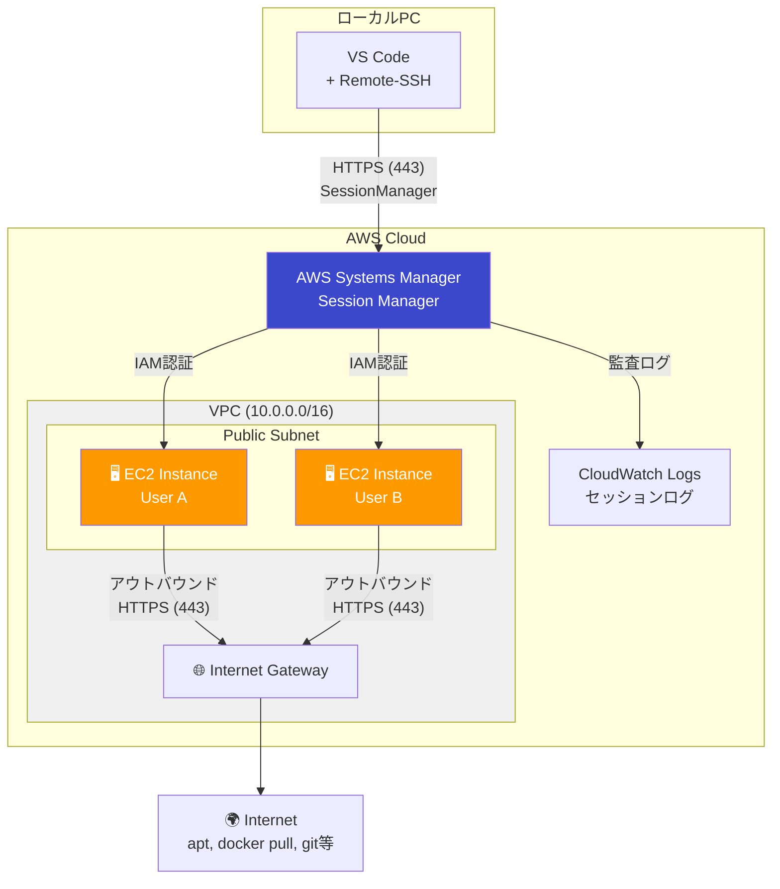
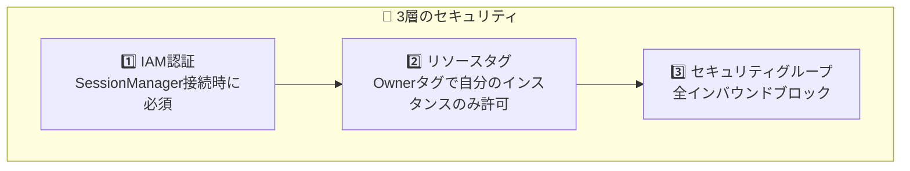

# EC2 Remote Workspace

AWS CDKを使用して、EC2上にセキュアなLinux開発環境を構築するプロジェクトです。

## 📋 プロジェクト概要

### 主な特徴

- **SessionManager経由のセキュアな接続** - SSH(22)ポートを開放せず、IAM認証でセキュアにアクセス
- **チーム開発対応** - 設定ファイル（`workspace-config.json`）でユーザーを定義し、各メンバーに独立したEC2環境を提供
- **DevContainer対応** - Docker環境がプリインストールされており、VS Code DevContainerでの開発が可能
- **Infrastructure as Code** - AWS CDKによる再現可能なインフラ構築

### 想定ユースケース

| ケース | 説明 |
|--------|------|
| **ローカルPCに制限がある場合** | 管理者権限なし、WSL使用不可、社内ポリシーでの制限など |
| **チーム開発環境の統一** | 全メンバーが同一構成の開発環境を使用 |
| **セキュアなリモート開発** | SSH不使用、IAM認証、監査ログ対応 |
| **高スペックな開発環境が必要** | ローカルPCよりもパワフルなEC2インスタンスを使用 |

---

## 🏗️ アーキテクチャ



### リソース構成


---

## 🔧 技術スタック

| カテゴリ | 技術 | 説明 |
|---------|------|------|
| IaC | AWS CDK (TypeScript) | 型安全なインフラ定義 |
| OS | Ubuntu 24.04 LTS | 2029年までサポート |
| インスタンス | t3.large (デフォルト) | 2vCPU / 8GB RAM |
| ストレージ | EBS gp3 100GB | 高速I/O、コスト効率 |
| 接続方式 | SSM SessionManager | SSH不要、IAM認証 |
| パッケージ管理 | pnpm | 高速な依存関係管理 |

### Public Subnet採用について

一般的にはPrivate Subnet + NAT Gatewayがベストプラクティスですが、本プロジェクトでは**Public Subnet**を採用しています。

| 項目 | 説明 |
|------|------|
| **コスト削減** | NAT Gateway ($45/月) + VPC Endpoints ($30/月) = **月$75削減** |
| **セキュリティ担保** | セキュリティグループで**全インバウンドをブロック**（SSHポート含む）<br/>アウトバウンド：HTTPS(443)、HTTP(80)、DNS(53)のみ許可 |
| **IAM認証** | SessionManager接続にはIAM認証が必須 |
| **監査ログ** | 全セッションをCloudWatch Logsに記録 |

> ⚠️ パブリックIPが付与されますが、セキュリティグループで全インバウンドをブロックするため、外部から直接接続することはできません。

### VPC/Subnet共有設計

VPCとSubnetはチームメンバー間で共有し、EC2インスタンスのみ個人ごとに分離します。

| リソース | 共有/分離 | 理由 |
|----------|----------|------|
| VPC | 共有 | コスト削減、管理容易 |
| Public Subnet | 共有 | 個別作成の必要なし |
| EC2インスタンス | **分離** | 完全に独立した開発環境 |
| セキュリティグループ | **分離** | インスタンスごとの通信制御 |
| IAMロール | **分離** | 最小権限の原則 |

### セキュリティ



| セキュリティ層 | 説明 |
|---------------|------|
| **IAM認証** | SessionManager接続にはAWS認証情報が必要 |
| **リソースタグによる制限** | `Owner`タグで自分のインスタンスのみアクセス可能 |
| **セキュリティグループ** | インバウンド：全拒否、アウトバウンド：HTTPS(443)、HTTP(80)、DNS(53)のみ許可 |
| **監査ログ** | CloudWatch Logsに全セッションを記録 |
| **EBS暗号化** | 全ボリュームをAWS管理キーで暗号化 |
| **IMDSv2強制** | インスタンスメタデータサービスv2を強制（SSRF対策） |

---

## 📋 前提条件

### 必要なツール

| ツール | バージョン | インストール |
|--------|-----------|-------------|
| Node.js | 22+ | [ダウンロード](https://nodejs.org/) |
| pnpm | 10+ | `npm install -g pnpm` |
| AWS CLI v2 | **2.32.0以降推奨** | [インストールガイド](https://docs.aws.amazon.com/cli/latest/userguide/getting-started-install.html) |
| Session Manager Plugin | 最新 | [インストールガイド](https://docs.aws.amazon.com/systems-manager/latest/userguide/session-manager-working-with-install-plugin.html) |

### AWS環境

- AWSアカウント
- IAMユーザーまたはルートユーザー
  - IAMユーザーの場合：`SignInLocalDevelopmentAccess` + CDKデプロイ権限
  - ルートユーザーの場合：追加権限不要
- AWS CLIバージョン確認：`aws --version`（2.32.0以降推奨）
- CDK Bootstrap済み（`cdk bootstrap`）

---

## 🚀 使用方法

### 1. リポジトリのクローン

```bash
git clone <repository-url>
cd ec2-remote-workspace
```

### 2. 依存関係のインストール

```bash
pnpm install
```

### 3. ユーザー設定

`workspace-config.json` を編集してプロジェクト設定とユーザーを定義します。

```json
{
  "$schema": "./workspace-config.schema.json",
  "projectName": "ec2-remote-workspace",
  "environment": "dev",
  "vpcCidr": "10.0.0.0/16",
  "defaultInstanceConfig": {
    "instanceType": "t3.large",
    "volumeSize": 100,
    "volumeType": "gp3"
  },
  "users": [
    {
      "username": "developer1",
      "displayName": "Developer One"
    },
    {
      "username": "developer2",
      "displayName": "Developer Two",
      "instanceConfig": {
        "instanceType": "t3.xlarge",
        "volumeSize": 200
      }
    }
  ]
}
```

#### 設定項目

| 項目 | 必須 | デフォルト | 説明 |
|------|:----:|-----------|------|
| `projectName` | | `ec2-remote-workspace` | プロジェクト名（リソース命名に使用） |
| `environment` | | `dev` | 環境名（dev, staging, prod） |
| `vpcCidr` | | `10.0.0.0/16` | VPCのCIDRブロック |
| `defaultInstanceConfig.instanceType` | | `t3.large` | EC2インスタンスタイプ |
| `defaultInstanceConfig.volumeSize` | | `100` | EBSボリュームサイズ（GB） |
| `defaultInstanceConfig.volumeType` | | `gp3` | EBSボリュームタイプ |
| `users` | ✅ | - | ユーザー配列（1人以上必須） |
| `users[].username` | ✅ | - | ユーザー名（小文字英数字、ハイフン、アンダースコア） |
| `users[].displayName` | | - | 表示名 |
| `users[].instanceConfig` | | - | ユーザー個別のインスタンス設定（デフォルトを上書き） |

### 4. AWS認証

AWS CLI 2.32.0以降では、`aws login` コマンドでブラウザ認証が可能です（推奨）。

```bash
# ブラウザで認証（AWS CLI 2.32.0以降）
aws login
```

> **✨ `aws login` のメリット:**
> - Identity Center不要でブラウザ認証可能
> - 一時認証情報が15分ごとに自動リフレッシュ
> - 長期アクセスキーの漏洩リスクを排除
> - IAMユーザーには `SignInLocalDevelopmentAccess` マネージドポリシーの付与が必要

<details>
<summary>従来の認証方法（AWS CLI 2.31.0以前）</summary>

```bash
# AWS SSOの場合
aws sso login --profile <profile-name>

# IAMユーザーの場合（非推奨）
aws configure
```

</details>

### 5. CDK Bootstrap（初回のみ）

```bash
pnpm cdk bootstrap
```

### 6. デプロイ

```bash
# 全スタックをデプロイ
pnpm cdk deploy --all

# 特定のスタックのみデプロイ
pnpm cdk deploy ec2-remote-workspace-dev-network       # ネットワークのみ
pnpm cdk deploy ec2-remote-workspace-dev-developer1    # 特定ユーザーのみ
```

### 7. デプロイ確認

デプロイ完了後、各スタックの出力でインスタンスIDと接続コマンドが表示されます。

```
Outputs:
ec2-remote-workspace-dev-developer1.InstanceId = i-0123456789abcdef0
ec2-remote-workspace-dev-developer1.ConnectCommand = aws ssm start-session --target i-0123456789abcdef0
```

---

## 📦 プリインストールソフトウェア

### Ubuntu 24.04 LTS 標準搭載

| カテゴリ | ソフトウェア |
|---------|-------------|
| **AWS** | SSM Agent（Systems Manager接続用） |

### User Dataスクリプトで自動インストール

EC2起動時に以下のソフトウェアが自動でインストールされます（[user-data.sh](lib/scripts/user-data.sh)）。

| カテゴリ | ソフトウェア |
|---------|-------------|
| **コンテナ** | Docker, Docker Compose |
| **AWS** | AWS CLI v2 |
| **開発ツール** | Git, vim, nano, curl, wget, jq, tree, htop |
| **ビルドツール** | build-essential |
| **システム設定** | 4GB スワップ領域、タイムゾーン（Asia/Tokyo） |

---

## 🔗 VS Code Remote-SSH接続

SessionManager経由でVS Code Remote-SSHを使用してEC2に接続できます。

### 前提条件（Windows）

- PowerShell 5.1以降
- VS Code + [Remote - SSH 拡張機能](https://marketplace.visualstudio.com/items?itemName=ms-vscode-remote.remote-ssh)
- AWS CLI v2
- Session Manager Plugin

### セットアップ手順

#### 1. インスタンスIDを取得

AWSコンソールまたはCLIでデプロイしたEC2インスタンスのIDを確認します。

```bash
# Linux/Mac/Windows (PowerShell)
aws ec2 describe-instances \
  --filters "Name=tag:Owner,Values=<username>" \
  --query 'Reservations[].Instances[].InstanceId' \
  --output text
```

#### 2. セットアップスクリプトを実行

**Windows:**

```powershell
.\scripts\setup-remote-ssh.ps1
```

**Linux/Mac:**

```bash
./scripts/setup-remote-ssh.sh
```

スクリプトが以下を行います：
- EC2インスタンスIDの入力を受け付け
- SSHホスト名の設定（デフォルト: `ec2`）
- AWSリージョンの設定（デフォルト: `ap-northeast-1`）
- AWS SSM Parameter Storeから秘密鍵を取得
- `~/.ssh/config` にSSM経由の接続設定を追加

#### 3. VS Codeから接続

1. VS Codeを開く
2. `Ctrl + Shift + P` → `Remote-SSH: Connect to Host...`
3. 設定したホスト名（例: `ec2`）を選択
4. プラットフォーム選択画面が表示されたら **Linux** を選択
5. 接続完了

---

## 🗑️ スタックの削除

```bash
# 全スタックを削除
pnpm cdk destroy --all

# 特定のスタックのみ削除
pnpm cdk destroy ec2-remote-workspace-dev-developer1

# ネットワークスタックは最後に削除（依存関係のため）
pnpm cdk destroy ec2-remote-workspace-dev-network
```

> ⚠️ EBSボリュームはインスタンス削除時に一緒に削除されます。必要なデータは事前にバックアップしてください。

---

## 💰 コスト見積もり

### 前提条件

- 使用時間：平日8時間 × 月20日 = **160時間/月**
- リージョン：ap-northeast-1（東京）
- インスタンス停止時はEC2料金は発生しない（EBSは継続課金）

### 月額コスト（1ユーザーあたり）

| リソース | スペック | 単価 | 月額コスト |
|----------|---------|------|-----------|
| EC2 (t3.large) | 2vCPU / 8GB | $0.1088/時間 | **$17.41** |
| EBS (gp3) | 100GB | $0.096/GB/月 | **$9.60** |
| データ転送 | 10GB想定 | $0.114/GB | **$1.14** |
| **合計** | | | **約 $28/月** |

### チーム規模別コスト

| 規模 | 月額コスト (USD) | 月額コスト (JPY) |
|------|-----------------|-----------------|
| 1ユーザー | 約 $28 | 約 ¥4,200 |
| 5ユーザー | 約 $141 | 約 ¥21,150 |
| 10ユーザー | 約 $282 | 約 ¥42,300 |

※ 1 USD = 150 JPY で計算

### コスト最適化オプション

| オプション | 効果 |
|-----------|------|
| Savings Plans (1年) | EC2 約30%割引 |
| t3.medium に変更 | EC2コスト約50%削減 |
| インスタンス自動停止 | 未使用時間のEC2コスト削減 |

---

## 📁 ディレクトリ構成

```
ec2-remote-workspace/
├── bin/
│   └── ec2-remote-workspace.ts   # CDKアプリエントリポイント
├── lib/
│   ├── constructs/
│   │   ├── vpc-construct.ts      # VPC構成
│   │   ├── security-construct.ts # セキュリティグループ・IAM
│   │   └── ec2-construct.ts      # EC2インスタンス
│   ├── stacks/
│   │   ├── network-stack.ts      # 共有ネットワークスタック
│   │   └── workspace-stack.ts    # 個人用ワークスペーススタック
│   ├── config/
│   │   └── workspace-config.ts   # 設定ファイル読み込み
│   └── scripts/
│       └── user-data.sh          # EC2初期化スクリプト
├── scripts/
│   ├── setup-remote-ssh.sh       # SSH設定スクリプト（Linux/Mac）
│   └── setup-remote-ssh.ps1      # SSH設定スクリプト（Windows）
├── test/                         # テストコード
├── workspace-config.json         # ユーザー・プロジェクト設定
├── workspace-config.schema.json  # 設定ファイルのJSONスキーマ
├── cdk.json                      # CDK設定
├── package.json
├── pnpm-lock.yaml
└── tsconfig.json
```

---

## 🧪 テスト

```bash
# テストを実行
pnpm test
```

---

## 📚 参考資料

- [VS Code Remote - SSH](https://code.visualstudio.com/docs/remote/ssh)
- [AWS CDK Documentation](https://docs.aws.amazon.com/cdk/v2/guide/home.html)
- [AWS Systems Manager Session Manager](https://docs.aws.amazon.com/systems-manager/latest/userguide/session-manager.html)
