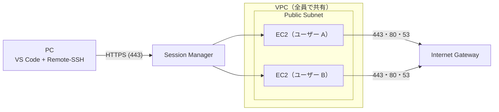

# EC2 Workstation

Docker の開発環境を作るための EC2 を、ユーザーごとに 1 台ずつ OpenTofu で作ります。
ユーザーは `workstation-config.json` に並べます。

接続は VS Code の Remote-SSH で、Session Manager を通します。
22 番ポートは開けません。

## 1. 前提

### ツール

- デプロイする人：AWS CLI v2、OpenTofu 1.10 以上、jq、jv（`./scripts/install/install-jv.sh`）、just（`./scripts/install/install-just.sh`）
- 接続する人：AWS CLI v2、Session Manager Plugin、VS Code と Remote - SSH 拡張機能、Windows なら Windows PowerShell 5.1 以上

スクリプトは、`install-jv.sh` で入れた jv しか使いません。
`install-just.sh` は `.tools/` に入れるので、PATH に足して使います。
CI と同じ版の OpenTofu は、`./scripts/install/install-tofu.sh` で `.tools/` に取れます。

### 権限

- デプロイする主体には、CodePipeline の apply のロールと同じ権限が要ります。[cloudformation/codepipeline.yaml](cloudformation/codepipeline.yaml) の `StatePolicy`・`ReadPolicy`・`WritePolicy` です。Deny の文も含めてそろえます。
- [3. AWS の準備](#3-aws-の準備) のスタックを作る主体には、別に CloudFormation と IAM（ポリシーとロールを作る）の権限が要ります。
- state のバケットを `SSE-KMS-CMK` にしたときは、state を読み書きする全員に、その鍵の `kms:Decrypt`・`kms:GenerateDataKey` が要ります。
- 接続する人の権限は、[5. 接続](#5-接続) にあります。

## 2. 設定

`workstation-config.json` に、プロジェクトとユーザーを書きます。

```json
{
  "$schema": "./workstation-config.schema.json",
  "projectName": "ec2-workstation",
  "environment": "dev",
  "awsRegion": "ap-northeast-1",
  "vpcCidr": "10.0.0.0/16",
  "defaultInstanceConfig": {
    "os": "al2023",
    "instanceType": "t3.medium",
    "rootVolumeSize": 30,
    "rootVolumeType": "gp3",
    "dataVolumeSize": 40,
    "dataVolumeType": "gp3"
  },
  "autoStopConfig": {
    "cpuThreshold": 3,
    "cpuEvaluationMinutes": 30,
    "scheduledStopHour": 23,
    "scheduledStopMinute": 0
  },
  "enableElasticIp": false,
  "users": [
    { "username": "developer1", "displayName": "Developer One" },
    {
      "username": "developer2",
      "displayName": "Developer Two",
      "instanceConfig": { "os": "ubuntu-24.04", "instanceType": "t3.xlarge", "dataVolumeSize": 200 },
      "enableElasticIp": true
    }
  ]
}
```

- `projectName`：リソースの名前の前置きです。
- `environment`：`dev`・`staging`・`prod` のどれかです。
- `awsRegion`：VPC とインスタンスを作るリージョンです。
- `defaultInstanceConfig`：全員の既定の OS・インスタンスタイプ（x86_64 だけ）・ボリュームの GB と種類です。
- `autoStopConfig`：CPU 使用率が `cpuThreshold`（%）未満のまま `cpuEvaluationMinutes` 分たつと止めます。毎日 `scheduledStopHour`:`scheduledStopMinute`（JST）にも止めます。
- `enableElasticIp`：Elastic IP を付けるかです。
- `users`：ユーザーごとに `username` を書きます。`instanceConfig`・`enableElasticIp` で既定を上書きできます。

仕様（必須・範囲・書き方）は [workstation-config.schema.json](workstation-config.schema.json) にあります。
`scripts/tofu-deploy.sh`・`scripts/tofu-init.sh` は、スキーマに合わない設定では何もせずに止まります。
`just validate-config` でも確かめられます。

後から変えるときの注意:

- `projectName`・`environment` を変えると、別の環境として新しく作られ、前の環境は管理されないまま残ります。変えるなら、先に `scripts/tofu-destroy.sh` で消し、新しい名前の boundary を作ります。CodePipeline なら、スタックの `ProjectName`・`Environment` も直します。
- `awsRegion` を変えると、前のリージョンの環境を見失います。先に `scripts/tofu-destroy.sh` で消します。CodePipeline なら、スタックの `DeployRegion` も直します。
- `scripts/tofu-destroy.sh` は、全員のデータボリュームも消します。データは取り戻せないので、先に退避します。
- `os` を変えると、インスタンスが作り直されます。データボリュームは残ります。ログインユーザーが変わるなら、`setup-remote-ssh` をやり直します。

### OS

`os` に書ける値と、そのログインユーザーです。

- `al2023`：Amazon Linux 2023。`ec2-user`
- `al2027-preview`：Amazon Linux 2027（プレビュー）。`ec2-user`
- `ubuntu-24.04`：Ubuntu 24.04 LTS。`ubuntu`
- `ubuntu-26.04`：Ubuntu 26.04 LTS。`ubuntu`
- `debian-13`：Debian 13。`admin`

`al2027-preview` は、AWS がプレビューの AMI のパラメータを消すと、全員の plan が失敗します。そのときは `os` を変えます。

## 3. AWS の準備

初回だけ、次の順に作ります。

1. state のバケット
2. permissions boundary
3. CodePipeline か GitHub Actions（使うときだけ）

### 3.1 state のバケット

[cloudformation/state-bucket.yaml](cloudformation/state-bucket.yaml) で、OpenTofu の state を置く S3 バケットを作ります。
アカウントに 1 つ作り、environment をまたいで使います。

1. スタックを `ap-northeast-1` に作ります。

   ```bash
   aws cloudformation deploy --region ap-northeast-1 \
     --template-file cloudformation/state-bucket.yaml \
     --stack-name ec2-workstation-tofu-state
   ```

   - リージョンは `ap-northeast-1` だけです。スクリプトがここで state を探します。
   - 鍵で守るなら、`--parameter-overrides Encryption=SSE-KMS-CMK` を足します。state には SSH の秘密鍵が平文で入ります。
   - `SSE-KMS-CMK` を選んだら、後から方式を変えないでください。古い state は、その鍵で暗号化されたまま残ります。
   - バケットの名前を決めるなら、`BucketName=<名前>` を足します。既定は `ec2-workstation-tofu-state-<account-id>` です。

2. 出力を見ます。

   ```bash
   aws cloudformation describe-stacks --region ap-northeast-1 --stack-name ec2-workstation-tofu-state \
     --query "Stacks[0].Outputs" --output table
   ```

   - `BucketName`：環境変数 `TF_STATE_BUCKET`、CodePipeline の `StateBucketName`、GitHub の secret `TF_STATE_BUCKET` に入れます。
   - `StateKmsKeyArn`：`SSE-KMS-CMK` のときだけ出ます。CodePipeline の `StateKmsKeyArn` に入れます。

スタックを消しても、バケットと鍵は残ります。
ほかのリージョンで作ると失敗し、空のスタックが `ROLLBACK_COMPLETE` で残ります。`aws cloudformation delete-stack --region <リージョン> --stack-name <スタック名>` で消します。

### 3.2 permissions boundary

[cloudformation/permissions-boundary.yaml](cloudformation/permissions-boundary.yaml) で、モジュールが作る IAM のロールの上限を作ります。
無いまま deploy すると、ロールを作る所で止まります。
`projectName` と `environment` の組ごとに 1 つ作ります。

```bash
aws cloudformation deploy \
  --template-file cloudformation/permissions-boundary.yaml \
  --stack-name <projectName>-<environment>-permissions-boundary \
  --capabilities CAPABILITY_NAMED_IAM \
  --parameter-overrides ProjectName=<projectName> Environment=<environment>
```

- `ProjectName`・`Environment`：`workstation-config.json` の `projectName`・`environment`
- IAM のポリシーなので、スタックはどのリージョンに作っても同じです。
- 出力は、どこにも渡しません。OpenTofu が名前から ARN を作ります。

### 3.3 deploy の道を選ぶ

- 手元：管理者が手元から回します。[1. 前提](#1-前提) のツールと権限が要ります。
- GitHub Actions：リポジトリが GitHub にあるときに使います。[3.5](#35-github-actions) のロールと secrets が要ります。
- CodePipeline：GitHub を使わず、AWS の中だけで回します。apply の前に承認を挟めます。[3.4](#34-codepipeline) のスタックが要ります。

どの道も、中身は同じ `scripts/tofu-deploy.sh` です。
deploy と destroy を同時に走らせないでください。state が network と workstations に分かれていて、ロックは片方ずつにしか効きません。

### 3.4 CodePipeline

[cloudformation/codepipeline.yaml](cloudformation/codepipeline.yaml) で、CodeCommit のリポジトリとパイプラインを作ります。

1. スタックを作ります。

   ```bash
   aws cloudformation deploy \
     --template-file cloudformation/codepipeline.yaml \
     --stack-name ec2-workstation-pipeline \
     --capabilities CAPABILITY_NAMED_IAM \
     --parameter-overrides \
       StateBucketName=<state の BucketName> \
       ProjectName=<projectName> Environment=<environment> DeployRegion=<awsRegion>
   ```

   - CodeCommit とパイプラインは、スタックを作ったリージョンにできます。
   - `ProjectName`・`Environment`：設定と違うと、権限が足りずに止まります。
   - `StateKmsKeyArn`：`SSE-KMS-CMK` のときだけ、state の出力 `StateKmsKeyArn` を足します。ap-northeast-1 の鍵の ARN で、エイリアスは使えません。空のままだと、plan の段が AccessDenied で止まります。
   - `ApprovalTopicArn`：承認を SNS で知らせるなら、トピックの ARN を足します。
   - スタック名を `<projectName>-<environment>-` で始めないでください。パイプラインのロールの名前が、apply のロールが扱う名前の前置きに当たります。

2. このリポジトリを、CodeCommit の `BranchName`（既定 `develop`）に push します。git-remote-codecommit を pip で入れ、スタックの出力 `RepositoryCloneUrlGrc` を push 先にします。

   ```bash
   pip install git-remote-codecommit
   git remote add codecommit <RepositoryCloneUrlGrc の値>
   git push codecommit develop
   ```

3. パイプラインが次の順に進みます。
   1. Check で `just ci` を走らせます。落ちたら plan に進みません。
   2. NetworkPlan で network を plan します。
   3. network に変更があれば、NetworkApprove で承認を待ち、NetworkApply で apply します。
   4. UsersPlan で、全員の plan と、設定から消えた人の destroy の plan を取ります。
   5. 変更があれば、Approve で全員分を 1 回で承認し、Apply で apply します。

承認するとき:

- 承認の画面の文は `commit / build / removed / replace / delete / create / update` の順です。作り直すアドレスの全部は、その plan の CodeBuild のログにあります。
- 要約だけでなく、コミットの差分も見てください。apply の段もリポジトリのスクリプトを走らせます。
- 承認は 7 日で期限が切れます。切れたら流し直します。
- apply が止まったら、原因を直してから **Release change** で流し直します。**Retry** は古い plan を使うので、必ず止まります。
- 承認を待つ間に push した実行は、apply の段で「plan が古い」で止まります。前の実行が終わってから **Release change** で流し直します。

plan のファイルには、state と同じく秘密鍵が入ります。アーティファクトのバケットは、スタックが作る KMS の鍵で暗号化します。

### 3.5 GitHub Actions

1. deploy に使う IAM のロールを作ります。
   - GitHub の OIDC（`token.actions.githubusercontent.com`）で、このリポジトリから引き受けられるようにします。
   - 権限は、CodePipeline の apply のロールと同じにします（[1. 前提](#権限)）。
2. リポジトリの secrets を 2 つ登録します。
   - `AWS_DEPLOY_ROLE_ARN`：1 のロールの ARN
   - `TF_STATE_BUCKET`：state の出力 `BucketName`
3. Actions の画面から **Deploy (OpenTofu)** を走らせます。

**Destroy (OpenTofu)** は、確認の欄に `destroy` と入れて走らせます。

## 4. デプロイ

```bash
export TF_STATE_BUCKET=<state のバケット>
./scripts/tofu-deploy.sh
```

`scripts/tofu-deploy.sh` は次のことをします。

1. network（VPC・サブネットなど、全員で使うもの）を plan して apply します。
2. 設定にいる全員の plan と、設定から消えた人の destroy の plan を取ります。
3. 2 の plan が全部通ったら apply し、消えた人の state を消します。1 つでも失敗したら、誰も apply しません。

端末で走らせると、変更のある段ごとに plan の要約を出し、`yes` を待ちます。
`yes` 以外なら、何も apply せずに終わります（終了コード 1）。
端末でないとき（CI）は、確かめずに進みます。

次のときは、apply せずに止まります。

- `workstation-config.json` がスキーマに合わない。
- VPC・サブネットを作り直す・消す変更がある（`vpcCidr` を変えたなど）。`scripts/tofu-destroy.sh` で全部を消してから、デプロイし直します。全員のデータボリュームも消え、取り戻せないので、先に退避します。

差分だけを見るとき、1 人分だけを apply するとき:

```bash
./scripts/tofu-init.sh network && tofu -chdir=opentofu/stacks/network plan

./scripts/tofu-init.sh workstations <username> && tofu -chdir=opentofu/stacks/workstations plan
./scripts/tofu-init.sh workstations <username> && tofu -chdir=opentofu/stacks/workstations apply
```

- `tofu-init.sh workstations <username>` は、その人の state（workspace）を選びます。
- 1 人分の apply は、ほかの人のインスタンスに触れません。設定から消えた人の destroy もしません。
- 出力は `tofu -chdir=opentofu/stacks/workstations output workstations` で見ます。

リージョンは 2 つあります。

- state のバケット: `ap-northeast-1` 固定（`scripts/lib/tofu-common.sh` の `STATE_REGION`）
- VPC とインスタンス: `awsRegion`

## 5. 接続

### 接続する人の権限

- `ec2:DescribeInstances`：Name タグからインスタンスを引き、状態を見ます。
- `ec2:StartInstances`：止まっているインスタンスを起動します。
- `ec2:DescribeKeyPairs`：キーペアの ID を引きます（setup）。
- `ssm:GetParameter`（`/ec2/keypair/*`）：秘密鍵を取ります（setup）。
- `ssm:DescribeInstanceInformation`：SSM Agent が通るまで待ちます。
- `ssm:StartSession`：接続します。

### Name タグ

接続先は、インスタンスの Name タグで指します。
Name タグは `<projectName>-<environment>-<username>-instance` です（例: `ec2-workstation-dev-developer1-instance`）。
インスタンスを作り直しても変わりません。

### セットアップ

Windows:

```powershell
powershell -NoProfile -ExecutionPolicy Bypass -File .\scripts\client\setup-remote-ssh.ps1
```

この形は、実行ポリシーを変えずに、このプロセスだけでスクリプトを許します。
グループポリシーで実行ポリシーが決まっている PC では効きません。

mac・Linux:

```bash
./scripts/client/setup-remote-ssh.sh
```

スクリプトは、Name タグ、SSH のホスト名（既定 `ec2`）、リージョン（既定 `ap-northeast-1`）を聞きます。
リージョンには `awsRegion` を入れます。

スクリプトがすること:

- 秘密鍵を SSM Parameter Store から取り、`~/.ssh/` に置きます。
- ログインユーザーを、インスタンスの `LoginUser` タグから取ります。
- 接続用のスクリプトを `~/.ssh/ec2-workstation-proxy-<ホスト名>.ps1`（`.sh`）に置きます。
- `~/.ssh/config` に、そのスクリプトを ProxyCommand にしたホストを足します。

接続用のスクリプトを新しい版にするときは、そのホストの setup をやり直します。

### VS Code

1. `Ctrl + Shift + P` → `Remote-SSH: Connect to Host...` を選びます。
2. 設定したホスト名（例: `ec2`）を選びます。
3. プラットフォームを聞かれたら、**Linux** を選びます。

## 6. 日々の使い方

### 起動

接続すると、止まっているインスタンスを起動し、SSM Agent が通るまで最長 5 分待ちます。
接続の前に起動しておくときは、次を走らせます。

```powershell
powershell -NoProfile -ExecutionPolicy Bypass -File .\scripts\client\start-ec2.ps1
```

```bash
./scripts/client/start-ec2.sh
```

### 停止

次のどちらかで、自動で止まります。

- CPU 使用率が `cpuThreshold` 未満のまま `cpuEvaluationMinutes` 分たったとき（CloudWatch Alarm）
- 毎日 `scheduledStopHour`:`scheduledStopMinute`（JST）（EventBridge Scheduler）

### AMI の更新とデータボリューム

apply のたびに、その OS の最新の AMI を引きます。
新しい AMI があれば、インスタンスを作り直します。
`~/work`、Docker のイメージ・コンテナ・ボリューム、`~/.gitconfig` はデータボリュームにあり、作り直しても残ります。
そのほか（dotfiles、入れたパッケージなど）はルートボリュームにあり、作り直すと消えます。

- user-data（[user-data.sh.tftpl](opentofu/modules/workstation/templates/user-data.sh.tftpl)）が変わったときも、インスタンスを作り直します。
- 起動中のインスタンスも、apply で止めてから作り直します。
- `scripts/tofu-deploy.sh` は全員を plan します。新しい AMI があれば、どの目的の deploy でも全員を作り直します。自分の分だけなら、[4. デプロイ](#4-デプロイ) の 1 人分の apply を使います。
- Docker のイメージは、OS の系統（Amazon Linux と Ubuntu・Debian）ごとに置き場所が違います。系統を変えると、戻すまで見えません。
- `dataVolumeSize` を増やすと、ボリュームはその場で大きくなります。ファイルシステムは作り直すまで広がらないので、すぐ使うなら `sudo resize2fs "$(findmnt -n -o SOURCE /data)"` を走らせます。
- `dataVolumeSize` は減らせません。apply で AWS が断ります。

### 困ったとき

データボリュームが付かずに起動したとき、`~/work` は書き込めなくなります。
インスタンスを作り直します。

```bash
./scripts/tofu-init.sh workstations <username>
tofu -chdir=opentofu/stacks/workstations apply -replace='module.workstation["<username>"].aws_instance.this'
```

SSM で入れないときは、user-data のログをシリアルコンソールの出力で読みます。

```bash
aws ec2 get-console-output --instance-id <instance-id> --latest --output text
```

user-data が fstab の所で ERROR を出して止まったときは、`/etc/fstab` を直してから、インスタンスの中で手で走らせます。
user-data が走らなかったとき（`/var/log/user-data.log` が無い）も同じですが、入れるのは Ubuntu だけです。ほかの OS は SSM Agent を user-data で入れるので、インスタンスを作り直します。

```bash
TOKEN=$(curl -fsS -X PUT http://169.254.169.254/latest/api/token -H "X-aws-ec2-metadata-token-ttl-seconds: 300")
curl -fsS -H "X-aws-ec2-metadata-token: $TOKEN" http://169.254.169.254/latest/user-data | gunzip > ~/user-data.sh
sudo bash ~/user-data.sh
```

一度走り切った後の再実行は想定していません。

### user-data にツールを足す

ルートに入れたツールを作り直しの後も残すには、[user-data.sh.tftpl](opentofu/modules/workstation/templates/user-data.sh.tftpl) に足します。
このファイルは OpenTofu の `templatefile` で展開します。

- `${VAR}` は `$${VAR}` と書きます。`$VAR` はそのまま書けます。
- `%{` は `%%{` と書きます。
- テンプレートに渡す値は `data_volume_id`・`username`・`login_user` の 3 つです。

## 7. ユーザーの追加と削除・全部の削除

### ユーザーの追加と削除

`workstation-config.json` の `users` を直して、デプロイします。
消した人のリソースと state は、次のデプロイで消えます。

> [!WARNING]
> ユーザーを消すと、データボリュームも消えます。スナップショットは残しません。残したいデータは先に退避してください。

### 全部の削除

次の順に消します。

1. `./scripts/tofu-destroy.sh` で、state を持つ全員の workstations と network を消します。端末なら段ごとに要約を出し、`yes` を待ちます。設定は検証しません。
2. CodePipeline を使ったなら、そのスタックを消します。
3. boundary のスタックを消します。
4. state のスタックを消します。バケットと鍵は残るので、要らなければ手で消します。

`scripts/tofu-destroy.sh` は、全員のデータボリュームを消します。データは取り戻せません。

CodePipeline のスタックは、アーティファクトのバケットを空にしてから消します。

```bash
bucket=$(aws cloudformation describe-stack-resource --stack-name <スタック名> --logical-resource-id ArtifactBucket --query StackResourceDetail.PhysicalResourceId --output text)
aws s3 rm "s3://$bucket" --recursive
aws cloudformation delete-stack --stack-name <スタック名>
```

- KMS の鍵は、7 日後に消えます。
- CodeCommit のリポジトリは残ります。

## 8. 構成



ユーザーごとに、EC2・データボリューム・セキュリティグループ・IAM ロール・キーペア・自動停止を作ります。
VPC・サブネット・Internet Gateway は、全員で 1 つです。

設計の理由:

- Public Subnet: NAT Gateway の費用をかけないためです。インバウンドはセキュリティグループで全部閉じます。
- VPC の共有: VPC は全員で同じでよく、分けるのは EC2 から下で足ります。

守り:

- インバウンドは全部拒みます。アウトバウンドは 443・80・53 だけです。
- IMDSv2 を強制します。
- EBS を暗号化します。
- VPC Flow Logs が、拒んだ通信を CloudWatch Logs に 30 日残します。
- 接続（StartSession）は CloudTrail の Event history に 90 日残ります。セッションの中の操作は記録しません。

user-data が入れるもの:

- Docker、Docker Compose、buildx
- AWS CLI v2
- Git、vim、nano、curl、wget（Amazon Linux を除く）、jq、tree、htop、uuidgen
- build-essential（Amazon Linux は gcc・gcc-c++・make）
- 4GB のスワップ、タイムゾーン Asia/Tokyo

## 9. コスト

1 人あたりの月額（USD）です。ディスクは、設定の例のとおりルート 30 GB・データ 40 GB の gp3 です。

| インスタンス | 動かす時間 | EC2 | ルートの EBS | データの EBS | パブリック IPv4 | Elastic IP（有効時） | 合計 |
|---|---|--:|--:|--:|--:|--:|--:|
| t3.medium | 平日 8 時間 | 9.43 | 2.88 | 3.84 | 0.87 | 3.65 | 17.02 |
| t3.medium | 24 時間 | 39.71 | 2.88 | 3.84 | 3.65 | 3.65 | 50.08 |
| t3.large | 平日 8 時間 | 18.86 | 2.88 | 3.84 | 0.87 | 3.65 | 26.45 |
| t3.large | 24 時間 | 79.42 | 2.88 | 3.84 | 3.65 | 3.65 | 89.79 |
| t3.xlarge | 平日 8 時間 | 37.72 | 2.88 | 3.84 | 0.87 | 3.65 | 45.30 |
| t3.xlarge | 24 時間 | 158.85 | 2.88 | 3.84 | 3.65 | 3.65 | 169.22 |

- 平日 8 時間は、月 173 時間（8 時間 × 21.7 日）です。24 時間は、月 730 時間です。
- 合計は、Elastic IP を使わないときの額です。Elastic IP を有効にすると、パブリック IPv4 の代わりに Elastic IP の額がかかります。EBS と Elastic IP は、止めている間もかかります。
- t3 は既定で unlimited です。ベースラインを超えて使い続けると、CPU クレジットが $0.05／vCPU 時間かかります。

チーム全体で 1 つの分:

| 項目 | 単価（USD） | 目安の月額（USD） |
|---|---|---|
| KMS の鍵 | 1／鍵・月 | state を `SSE-KMS-CMK` にすると 1、CodePipeline を使うと 1 |
| CodePipeline | 0.002／アクションの実行分（月 100 分まで無料） | アクションが月 300 分なら 0.40 |
| CodeBuild（general1.small） | 0.005／分（月 100 分まで無料） | 月 300 分なら 1.00 |
| VPC Flow Logs | 取り込み 0.76／GB、保存 0.033／GB・月 | 拒んだ通信が月 1 GB なら 0.79 |
| CloudWatch のアラーム | 0.10／個・月（10 個まで無料） | 1 人に 1 個。20 人なら 1.00 |
| S3（state） | 0.025／GB・月 | 0.01 未満 |
| インターネットへのデータ転送 | 0.114／GB（月 100 GB まで無料） | 月 200 GB なら 11.40 |

2026-10-30 時点の ap-northeast-1 の価格です。税抜きです。

## 10. 開発

- `opentofu/`：OpenTofu のモジュールと stack（[opentofu/README.md](opentofu/README.md)）
- `cloudformation/`：state のバケット、permissions boundary、CodePipeline のテンプレートと buildspec
- `scripts/`：deploy・destroy のスクリプト。道具の取り込みは `install/`、テストは `tests/` にあります。
- `scripts/client/`：利用者の PC で走らせるスクリプト
- `schemas/`：スキーマの書き間違いを断る draft-07 のメタスキーマ
- `workstation-config.json`・`workstation-config.schema.json`：設定とそのスキーマ

```bash
just ci
```

- `just ci` は GitHub Actions の CI と同じ検査を走らせます。
- `just ci` が使う道具（shellcheck・shfmt・gitleaks・pwsh など）は、`scripts/install/` の `install-*.sh` で入れます。
- Windows PowerShell 5.1 での検査は、GitHub Actions だけが行います。
