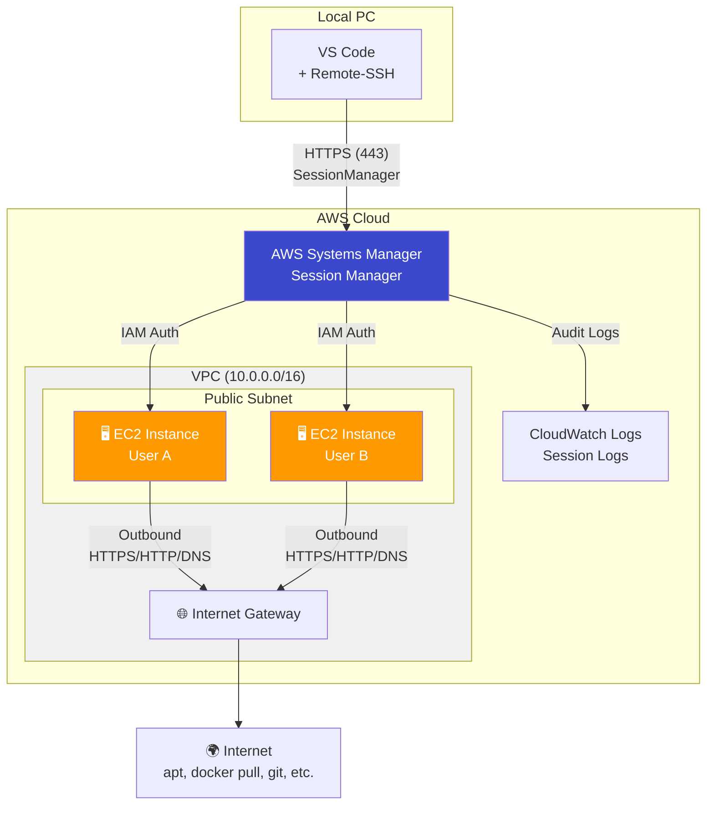
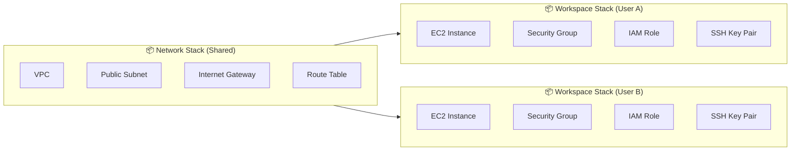
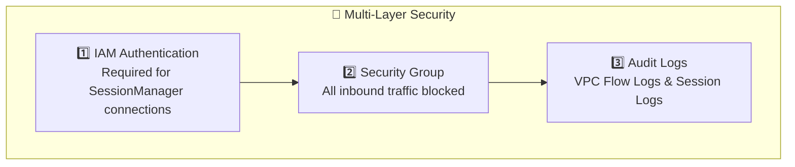
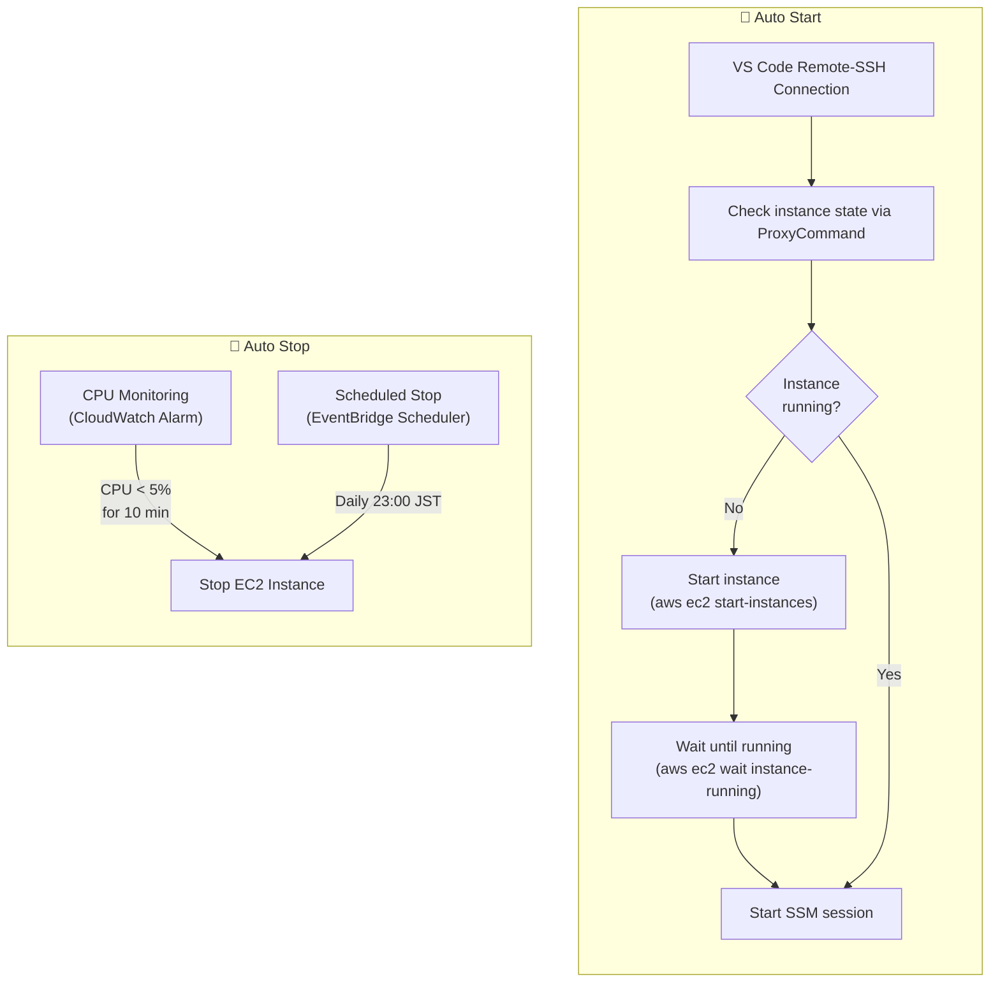

> 🇯🇵 [日本語版はこちら](docs/README.ja.md)

# EC2 Remote Workspace

A project that builds a secure Linux development environment on EC2 using AWS CDK (with an equivalent OpenTofu implementation also available).

## 📋 Project Overview

### Key Features

- **Secure Connection via SessionManager** - Access securely with IAM authentication without opening SSH (22) port
- **Team Development Support** - Define users in a configuration file (`workspace-config.json`) and provide each member with an independent EC2 environment
- **DevContainer Support** - Docker environment is pre-installed, enabling development with VS Code DevContainers
- **Infrastructure as Code** - Reproducible infrastructure provisioning with AWS CDK or OpenTofu (both implementations share the same configuration file)

### Use Cases

| Case | Description |
|------|-------------|
| **Limited Local PC** | No admin privileges, WSL unavailable, corporate policy restrictions, etc. |
| **Unified Team Development Environment** | All members use identically configured development environments |
| **Secure Remote Development** | No SSH, IAM authentication, audit logging |
| **High-Spec Development Environment Needed** | Use EC2 instances more powerful than local PCs |

---

## 🏗️ Architecture



### Resource Structure



---

## 🔧 Technology Stack

| Category | Technology | Description |
|----------|-----------|-------------|
| IaC | AWS CDK (TypeScript) / OpenTofu | Type-safe infrastructure definitions (choose either implementation) |
| OS | Ubuntu 24.04 LTS | Supported until 2029 |
| Instance | t3.medium (default) | 2vCPU / 4GB RAM |
| Storage | EBS gp3 80GB | High-speed I/O, cost-efficient |
| Connectivity | SSM SessionManager | No SSH required, IAM authentication |
| Package Manager | pnpm | Fast dependency management |

### Why Public Subnet?

While Private Subnet + NAT Gateway is generally considered best practice, this project uses a **Public Subnet**.

| Item | Description |
|------|-------------|
| **Cost Reduction** | NAT Gateway ($45/mo) + VPC Endpoints ($30/mo) = **$75/mo savings** |
| **Security Assurance** | Security Group **blocks all inbound traffic** (including SSH port)<br/>Outbound: Only HTTPS (443), HTTP (80), DNS (53) allowed |
| **IAM Authentication** | IAM authentication is required for SessionManager connections |
| **Audit Logs** | All sessions are logged to CloudWatch Logs |

> ⚠️ A public IP is assigned, but since the Security Group blocks all inbound traffic, direct external connections are not possible.

### VPC/Subnet Shared Design

The VPC and Subnet are shared among team members, with only EC2 instances isolated per individual.

| Resource | Shared/Isolated | Reason |
|----------|----------------|--------|
| VPC | Shared | Cost reduction, easier management |
| Public Subnet | Shared | No need for individual creation |
| EC2 Instance | **Isolated** | Fully independent development environment |
| Security Group | **Isolated** | Per-instance traffic control |
| IAM Role | **Isolated** | Principle of least privilege |

### Security



| Security Layer | Description |
|---------------|-------------|
| **IAM Authentication** | AWS credentials are required for SessionManager connections |
| **Security Group** | Inbound: All denied, Outbound: Only HTTPS (443), HTTP (80), DNS (53) allowed |
| **VPC Flow Logs** | Rejected traffic is logged to CloudWatch Logs (for security auditing, retention: 1 month) |
| **Session Logs** | All SessionManager sessions are logged to CloudWatch Logs |
| **EBS Encryption** | All volumes are encrypted with AWS managed keys |
| **IMDSv2 Enforcement** | Instance Metadata Service v2 is enforced (SSRF protection) |
| **Resource Tags** | Resources are identified by the `Owner` tag (for management and filtering) |

### Auto Start / Auto Stop

Auto start and auto stop features for EC2 instances are provided to reduce costs.



| Feature | Method | Description |
|---------|--------|-------------|
| **Auto Start** | ProxyCommand | Automatically starts the instance if stopped during SSH connection and waits for startup to complete |
| **CPU Monitoring Stop** | CloudWatch Alarm | Automatically stops the instance if CPU usage stays below the threshold for a specified period (configurable) |
| **Scheduled Stop** | EventBridge Scheduler | Automatically stops the instance daily at a specified time in JST (configurable) |

> 💡 **Cost Savings**: Reduces EC2 charges during unused hours. While EBS charges still apply when the instance is stopped, EC2 hourly charges do not.
>
> ⚙️ **Configuration**: Customize the CPU threshold, monitoring period, and scheduled stop time in the `autoStopConfig` section of `workspace-config.json`.

---

## 📋 Prerequisites

### Required Tools

| Tool | Version | Installation |
|------|---------|-------------|
| Node.js | 24+ | [Download](https://nodejs.org/) |
| pnpm | 10+ | `npm install -g pnpm` |
| AWS CLI v2 | **2.32.0 or later recommended** | [Installation Guide](https://docs.aws.amazon.com/cli/latest/userguide/getting-started-install.html) |
| Session Manager Plugin | Latest | [Installation Guide](https://docs.aws.amazon.com/systems-manager/latest/userguide/session-manager-working-with-install-plugin.html) |

### AWS Environment

- AWS account
- IAM user or root user
  - For IAM users: `SignInLocalDevelopmentAccess` + CDK deployment permissions + EC2 start permissions
  - For root users: No additional permissions required
- Check AWS CLI version: `aws --version` (2.32.0 or later recommended)
- CDK bootstrapped (`cdk bootstrap`)

---

## 🚀 Usage

### 1. Clone the Repository

```bash
git clone <repository-url>
cd ec2-remote-workspace
```

### 2. Install Dependencies

```bash
pnpm install
```

### 3. User Configuration

Edit `workspace-config.json` to define project settings and users.

```json
{
  "$schema": "./workspace-config.schema.json",
  "projectName": "ec2-remote-workspace",
  "environment": "dev",
  "vpcCidr": "10.0.0.0/16",
  "defaultInstanceConfig": {
    "instanceType": "t3.medium",
    "volumeSize": 80,
    "volumeType": "gp3"
  },
  "autoStopConfig": {
    "cpuThreshold": 5,
    "cpuEvaluationMinutes": 10,
    "scheduledStopHour": 23,
    "scheduledStopMinute": 0
  },
  "users": [
    {
      "username": "developer1",
      "displayName": "Developer One"
    },
    {
      "username": "developer2",
      "displayName": "Developer Two",
      "instanceConfig": {
        "instanceType": "t3.xlarge",
        "volumeSize": 200
      }
    }
  ]
}
```

#### Configuration Items

| Item | Required | Default | Description |
|------|:--------:|---------|-------------|
| `projectName` | | `ec2-remote-workspace` | Project name (used for resource naming) |
| `environment` | | `dev` | Environment name (dev, staging, prod) |
| `vpcCidr` | | `10.0.0.0/16` | VPC CIDR block |
| `defaultInstanceConfig.instanceType` | | `t3.medium` | EC2 instance type |
| `defaultInstanceConfig.volumeSize` | | `80` | EBS volume size (GB) |
| `defaultInstanceConfig.volumeType` | | `gp3` | EBS volume type |
| `autoStopConfig.cpuThreshold` | | `5` | CPU usage threshold (%) - stops when usage stays below this value |
| `autoStopConfig.cpuEvaluationMinutes` | | `10` | CPU monitoring period (minutes) - stops after sustained low usage for this period |
| `autoStopConfig.scheduledStopHour` | | `23` | Scheduled stop time (hour, 0-23, Asia/Tokyo) |
| `autoStopConfig.scheduledStopMinute` | | `0` | Scheduled stop time (minute, 0-59) |
| `enableElasticIp` | | `false` | Assign Elastic IP (static public IP) to all users by default. Per-user override available. |
| `users` | ✅ | - | User array (at least one required) |
| `users[].username` | ✅ | - | Username (lowercase alphanumeric, hyphens, underscores) |
| `users[].displayName` | | - | Display name |
| `users[].instanceConfig` | | - | Per-user instance configuration (overrides defaults) |
| `users[].enableElasticIp` | | - | Per-user Elastic IP override (overrides project-level `enableElasticIp`) |

### 4. AWS Authentication

With AWS CLI 2.32.0 or later, browser-based authentication is available via the `aws login` command (recommended).

```bash
# Authenticate via browser (AWS CLI 2.32.0 or later)
aws login
```

> **✨ Benefits of `aws login`:**
> - Browser-based authentication without requiring Identity Center
> - Temporary credentials auto-refresh every 15 minutes
> - Eliminates the risk of long-term access key leaks
> - IAM users need the `SignInLocalDevelopmentAccess` managed policy attached

<details>
<summary>Legacy authentication methods (AWS CLI 2.31.0 or earlier)</summary>

```bash
# For AWS SSO
aws sso login --profile <profile-name>

# For IAM users (not recommended)
aws configure
```

</details>

### 5. CDK Bootstrap (First Time Only)

```bash
pnpm cdk bootstrap
```

### 6. Deploy

```bash
# Deploy all stacks
pnpm cdk deploy --all

# Deploy specific stacks only
pnpm cdk deploy ec2-remote-workspace-dev-network       # Network only
pnpm cdk deploy ec2-remote-workspace-dev-developer1    # Specific user only
```

### 7. Verify Deployment

After deployment is complete, the instance ID and connection command will be displayed in each stack's outputs.

```
Outputs:
ec2-remote-workspace-dev-developer1.InstanceId = i-0123456789abcdef0
ec2-remote-workspace-dev-developer1.ConnectCommand = aws ssm start-session --target i-0123456789abcdef0
```

### Deploying with OpenTofu (Alternative)

The same infrastructure can be provisioned with OpenTofu instead of CDK. Both implementations share `workspace-config.json`, the user-data script, and the operation scripts, so the post-deployment workflow (Remote-SSH setup, auto start/stop) is identical.

```bash
cd opentofu
tofu init -backend-config="bucket=<your-state-bucket>" \
          -backend-config="key=ec2-remote-workspace/dev/terraform.tfstate" \
          -backend-config="region=ap-northeast-1"
tofu apply
```

> ⚠️ Do **not** apply both CDK and OpenTofu to the same account with the same `projectName`/`environment` — they create resources with identical physical names. See [opentofu/README.md](opentofu/README.md) for details, prerequisites, and state protection notes.

---

## 📦 Pre-installed Software

### Included in Ubuntu 24.04 LTS

| Category | Software |
|----------|----------|
| **AWS** | SSM Agent (for Systems Manager connectivity) |

### Automatically Installed via User Data Script

The following software is automatically installed at EC2 launch ([user-data.sh](shared/user-data.sh)).

| Category | Software |
|----------|----------|
| **Containers** | Docker, Docker Compose |
| **AWS** | AWS CLI v2 |
| **Development Tools** | Git, vim, nano, curl, wget, jq, tree, htop, uuidgen |
| **Build Tools** | build-essential |
| **System Settings** | 4GB swap space, timezone (Asia/Tokyo) |

---

## 🔗 VS Code Remote-SSH Connection

You can connect to EC2 using VS Code Remote-SSH via SessionManager.

### Prerequisites (Windows)

- PowerShell 5.1 or later
- VS Code + [Remote - SSH Extension](https://marketplace.visualstudio.com/items?itemName=ms-vscode-remote.remote-ssh)
- AWS CLI v2
- Session Manager Plugin

### Setup Steps

#### 1. Get the Instance ID

Check the deployed EC2 instance ID via the AWS Console or CLI.

```bash
# Linux/Mac/Windows (PowerShell)
aws ec2 describe-instances \
  --filters "Name=tag:Owner,Values=<username>" \
  --query 'Reservations[].Instances[].InstanceId' \
  --output text
```

#### 2. Run the Setup Script

**Windows:**

```powershell
.\scripts\setup-remote-ssh.ps1
```

**Linux/Mac:**

```bash
./scripts/setup-remote-ssh.sh
```

The script performs the following:
- Prompts for the EC2 instance ID
- Configures the SSH host name (default: `ec2`)
- Configures the AWS region (default: `ap-northeast-1`)
- Retrieves the private key from AWS SSM Parameter Store
- Copies the auto-start script (`start-ec2-and-wait.ps1` / `start-ec2-and-wait.sh`) to `~/.ssh/`
- Adds an SSM-based connection entry to `~/.ssh/config` (with auto-start enabled via ProxyCommand)

#### 3. Connect from VS Code

1. Open VS Code
2. `Ctrl + Shift + P` → `Remote-SSH: Connect to Host...`
3. Select the configured host name (e.g., `ec2`)
4. If prompted for the platform, select **Linux**
5. Connection complete

> 💡 **Auto Start Feature**: When connecting via VS Code, if the EC2 instance is stopped, it will automatically start and wait until the SSM Agent connection is ready (up to 5 minutes). The first connection may take 2-3 minutes for startup.

#### 4. Manually Start the EC2 Instance (Optional)

If you want to manually start the instance before connecting via VS Code, run the following script.

**Windows:**

```powershell
.\scripts\start-ec2.ps1
```

**Linux/Mac:**

```bash
./scripts/start-ec2.sh
```

The script interactively asks for the instance ID and region, then starts the instance and waits until the SSM Agent connection is ready.

---

## 🗑️ Stack Deletion

```bash
# Delete all stacks
pnpm cdk destroy --all

# Delete a specific stack only
pnpm cdk destroy ec2-remote-workspace-dev-developer1

# Delete the network stack last (due to dependencies)
pnpm cdk destroy ec2-remote-workspace-dev-network
```

> ⚠️ EBS volumes are deleted together with the instance. Please back up any necessary data beforehand.

---

## 💰 Cost Estimate

### Assumptions

- Usage: 8 hours/weekday × 20 days/month = **160 hours/month**
- Region: ap-northeast-1 (Tokyo)
- EC2 charges do not apply when the instance is stopped (EBS charges continue)
- Elastic IP charges ($0.005/hour) apply even when the instance is stopped

### Monthly Cost (Per User)

| Resource | Spec | Unit Price | Monthly Cost |
|----------|------|-----------|-------------|
| EC2 (t3.medium) | 2vCPU / 4GB | $0.0544/hour | **$8.70** |
| EBS (gp3) | 80GB | $0.096/GB/month | **$7.68** |
| Data Transfer | 10GB estimated | $0.114/GB | **$1.14** |
| Elastic IP | Optional (if enabled) | $0.005/hour | **$3.65** |
| **Subtotal (per user)** | | | **~$17.5/month** |

### Shared Resource Costs (Entire Team)

| Resource | Description | Monthly Cost |
|----------|-------------|-------------|
| VPC Flow Logs | Log ingestion to CloudWatch Logs | **~$0.76/GB** |
| CloudWatch Logs | Session Logs + Flow Logs storage | **$0.033/GB/month** |

> 💡 Since VPC Flow Logs are configured to record only REJECT traffic, the log volume is typically a few MB to tens of MB per month.

### Cost by Team Size

| Scale | Monthly Cost (USD) | Monthly Cost (JPY) |
|-------|-------------------|-------------------|
| 1 user | ~$17.5 | ~¥2,625 |
| 5 users | ~$87.5 | ~¥13,125 |
| 10 users | ~$175 | ~¥26,250 |

※ Calculated at 1 USD = 150 JPY

### Cost Optimization Options

| Option | Effect |
|--------|--------|
| Savings Plans (1 year) | ~30% discount on EC2 |
| Switch to t3.small | ~50% reduction in EC2 costs |
| Instance auto stop | Reduce EC2 costs during unused hours |

---

## 📁 Directory Structure

```
ec2-remote-workspace/
├── cdk/                          # AWS CDK implementation
│   ├── bin/
│   │   └── ec2-remote-workspace.ts   # CDK app entry point
│   ├── lib/
│   │   ├── constructs/
│   │   │   ├── vpc-construct.ts      # VPC configuration
│   │   │   ├── security-construct.ts # Security Group & IAM
│   │   │   ├── ec2-construct.ts      # EC2 instance
│   │   │   └── auto-stop-construct.ts # Auto stop (CPU monitoring & scheduled stop)
│   │   ├── stacks/
│   │   │   ├── network-stack.ts      # Shared network stack
│   │   │   └── workspace-stack.ts    # Individual workspace stack
│   │   └── config/
│   │       └── workspace-config.ts   # Configuration file loader
│   ├── test/                         # Test code
│   ├── cdk.json                      # CDK configuration
│   └── tsconfig.json
├── opentofu/                     # OpenTofu implementation (same infrastructure as CDK)
│   ├── modules/
│   │   ├── network/              # VPC, Subnet, IGW, Flow Logs
│   │   └── workspace/            # SG, IAM, EC2, Key Pair, Auto stop
│   ├── locals.tf                 # workspace-config.json loader (shared with CDK)
│   ├── main.tf
│   └── README.md                 # OpenTofu usage guide
├── shared/
│   └── user-data.sh              # EC2 initialization script (shared across IaC tools)
├── scripts/
│   ├── setup-remote-ssh.sh       # SSH setup script (Linux/Mac)
│   ├── setup-remote-ssh.ps1      # SSH setup script (Windows)
│   ├── start-ec2-and-wait.sh     # EC2 auto-start script (for ProxyCommand, Linux/Mac)
│   ├── start-ec2-and-wait.ps1    # EC2 auto-start script (for ProxyCommand, Windows)
│   ├── start-ec2.sh              # EC2 manual start script (Linux/Mac)
│   └── start-ec2.ps1             # EC2 manual start script (Windows)
├── workspace-config.json         # User & project configuration
├── workspace-config.schema.json  # Configuration file JSON schema
├── package.json
└── pnpm-lock.yaml
```

---

## 🧪 Tests

```bash
# Run tests
pnpm test
```

---

## 📚 References

- [VS Code Remote - SSH](https://code.visualstudio.com/docs/remote/ssh)
- [AWS CDK Documentation](https://docs.aws.amazon.com/cdk/v2/guide/home.html)
- [AWS Systems Manager Session Manager](https://docs.aws.amazon.com/systems-manager/latest/userguide/session-manager.html)
