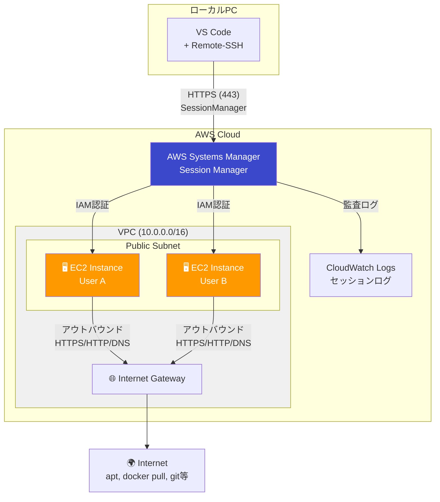
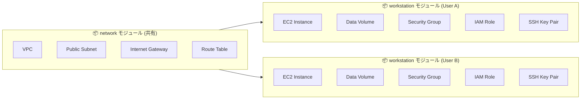
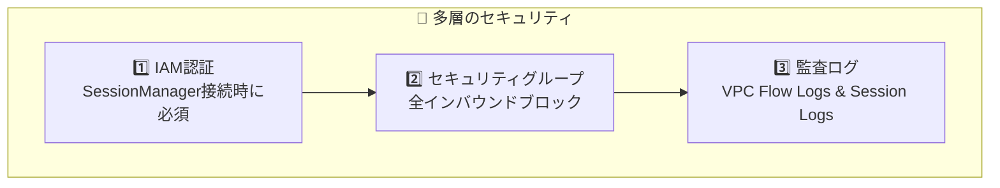
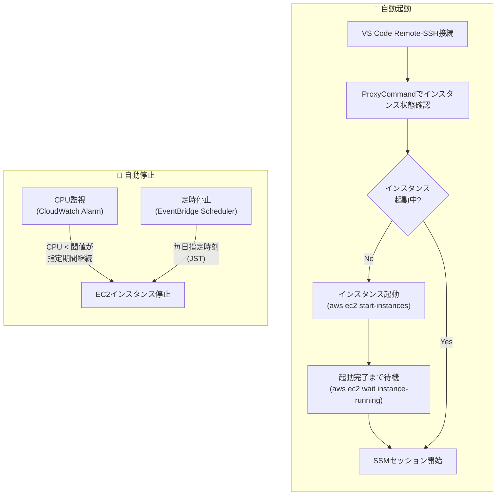

# EC2 Workstation

OpenTofu を使用して、EC2上にセキュアなLinux開発環境を構築するプロジェクトです。

## 📋 プロジェクト概要

### 主な特徴

- **SessionManager経由のセキュアな接続** - SSH(22)ポートを開放せず、IAM認証でセキュアにアクセス
- **チーム開発対応** - 設定ファイル（`workstation-config.json`）でユーザーを定義し、各メンバーに独立したEC2環境を提供
- **DevContainer対応** - Docker環境がプリインストールされており、VS Code DevContainerでの開発が可能
- **Infrastructure as Code** - OpenTofu による再現可能なインフラ構築

### 想定ユースケース

| ケース | 説明 |
|--------|------|
| **ローカルPCに制限がある場合** | 管理者権限なし、WSL使用不可、社内ポリシーでの制限など |
| **チーム開発環境の統一** | 全メンバーが同一構成の開発環境を使用 |
| **セキュアなリモート開発** | SSH不使用、IAM認証、監査ログ対応 |
| **高スペックな開発環境が必要** | ローカルPCよりもパワフルなEC2インスタンスを使用 |

---

## 🏗️ アーキテクチャ



### リソース構成



---

## 🔧 技術スタック

| カテゴリ | 技術 | 説明 |
|---------|------|------|
| IaC | OpenTofu | 宣言的なインフラ構築 |
| OS | Ubuntu 24.04 LTS | 2029年までサポート |
| インスタンス | EC2（タイプは `workstation-config.json` で指定） | ユーザー単位で上書き可（例: t3.medium = 2vCPU / 4GB RAM） |
| ストレージ | EBS gp3 / gp2（ルート + データの 2 本。サイズ・タイプは `workstation-config.json` で指定） | 暗号化有効、データボリュームは AMI 更新後も残る |
| 接続方式 | SSM SessionManager | SSH不要、IAM認証 |

### Public Subnet採用について

一般的にはPrivate Subnet + NAT Gatewayがベストプラクティスですが、本プロジェクトでは**Public Subnet**を採用しています。

| 項目 | 説明 |
|------|------|
| **コスト削減** | NAT Gateway ($45/月) + VPC Endpoints ($30/月) = **月$75削減** |
| **セキュリティ担保** | セキュリティグループで**全インバウンドをブロック**（SSHポート含む）<br/>アウトバウンド：HTTPS(443)、HTTP(80)、DNS(53)のみ許可 |
| **IAM認証** | SessionManager接続にはIAM認証が必須 |
| **監査ログ** | 全セッションをCloudWatch Logsに記録 |

> ⚠️ パブリックIPが付与されますが、セキュリティグループで全インバウンドをブロックするため、外部から直接接続することはできません。

### VPC/Subnet共有設計

VPCとSubnetはチームメンバー間で共有し、EC2インスタンスのみ個人ごとに分離します。

| リソース | 共有/分離 | 理由 |
|----------|----------|------|
| VPC | 共有 | コスト削減、管理容易 |
| Public Subnet | 共有 | 個別作成の必要なし |
| EC2インスタンス | **分離** | 完全に独立した開発環境 |
| セキュリティグループ | **分離** | インスタンスごとの通信制御 |
| IAMロール | **分離** | 最小権限の原則 |

### セキュリティ



| セキュリティ層 | 説明 |
|---------------|------|
| **IAM認証** | SessionManager接続にはAWS認証情報が必要 |
| **セキュリティグループ** | インバウンド：全拒否、アウトバウンド：HTTPS(443)、HTTP(80)、DNS(53)のみ許可 |
| **VPC Flow Logs** | 拒否されたトラフィックをCloudWatch Logsに記録（セキュリティ監査用、保持期間：1ヶ月） |
| **セッションログ** | SessionManagerの全セッションをCloudWatch Logsに記録 |
| **EBS暗号化** | 全ボリュームをAWS管理キーで暗号化 |
| **IMDSv2強制** | インスタンスメタデータサービスv2を強制（SSRF対策） |
| **リソースタグ** | `Owner`タグでリソースを識別（管理・フィルタリング用） |

### 自動起動・自動停止

コスト削減のため、EC2インスタンスの自動起動・自動停止機能を提供しています。



| 機能 | 方式 | 説明 |
|------|------|------|
| **自動起動** | ProxyCommand | SSH接続時にインスタンスが停止中なら自動起動し、起動完了まで待機 |
| **CPU監視停止** | CloudWatch Alarm | CPU使用率が閾値未満の状態が指定期間続くと自動停止（設定可能） |
| **定時停止** | EventBridge Scheduler | 毎日指定時刻（JST）に自動停止（設定可能） |

> 💡 **コスト削減効果**: 使用していない時間帯のEC2料金を削減できます。インスタンスが停止中でもEBS料金は発生しますが、EC2の時間課金は発生しません。
>
> ⚙️ **設定変更**: `workstation-config.json` の `autoStopConfig` で CPU閾値、監視期間、定時停止時刻をカスタマイズできます。

### AMI の自動更新とデータボリューム

`tofu apply` のたびに最新の AMI を参照し、新しい AMI が公開されていればインスタンスを作り直します（OS・パッケージを AMI 単位で更新する）。作業データはインスタンスと独立した**データボリューム**に置くため、作り直し後もそのまま残ります。

| 場所 | 置き場所 | AMI 更新後 |
|------|---------|-----------|
| `~/work` | データボリューム（`/data/work` を bind mount） | 残る |
| Docker のイメージ・コンテナ・ボリューム | データボリューム（`/var/lib/docker`・`/var/lib/containerd` を bind mount） | 残る |
| `~/.gitconfig` | データボリューム（`/data/gitconfig` へのシンボリックリンク） | 残る |
| 上記以外（dotfiles、apt で入れたパッケージなど） | ルートボリューム | **消える** |

- 作り直しの流れ: 旧インスタンスを停止 → データボリュームをデタッチ → 旧インスタンス削除 → 新インスタンス作成 → データボリュームをアタッチ → user-data がマウント
- 起動中のインスタンスも `apply` で停止されます。新しい AMI があるかは `tofu plan` で `aws_instance` が `-/+` になるかで確認できます
- 新しい AMI が出ていれば、ユーザーの追加など**どの目的の `apply` でも全員のインスタンスが作り直されます**。作業中のメンバーがいるときは `tofu plan` で確認してから実行してください
- インスタンス ID は作り直しのたびに変わります。接続スクリプトは Name タグでインスタンスを探すため、`setup-remote-ssh` のやり直しは不要です
- ルートに入れたツールを残したい場合は [user-data.sh](shared/user-data.sh) に追加してください
- データボリュームがアタッチされないまま起動した場合、`~/work` は書き込み禁止になります（ルートボリュームに書いて次の作り直しで失うのを防ぐため）。`/var/log/user-data.log` の案内に従い、`tofu apply -replace='module.workstation["<username>"].aws_instance.this'` でインスタンスを作り直してください

#### データボリュームを持たない環境から移る場合

データボリュームが無い構成（`ignore_changes = [ami]` で AMI を固定していた版）で作ったインスタンスは、この版での最初の `apply` で作り直され、**ルートボリューム上の `~/work` と Docker のデータは新しいデータボリュームに移りません**（初回のデータボリュームは空です）。最初の `apply` の前に退避してください。

```bash
# 1. 残したい Docker ボリュームを ~/work に tar で書き出す（旧インスタンスに接続できる SSH 設定のまま）
ssh ec2 'docker run --rm -v <volume>:/v -v ~/work:/b alpine tar czf /b/<volume>.tgz -C /v .'

# 2. ~/work をローカルへ退避する
rsync -a ec2:~/work/ ./work-backup/

# 3. 新しい構成をデプロイし、setup-remote-ssh をやり直す（HostName が Name タグに変わるため）
cd opentofu && tofu apply
./scripts/setup-remote-ssh.sh

# 4. 新しいインスタンスへ戻す
rsync -a ./work-backup/ ec2:~/work/
```

Docker イメージは移さず、必要なものを pull し直してください。

---

## 📋 前提条件

### 必要なツール（共通）

| ツール | バージョン | インストール |
|--------|-----------|-------------|
| AWS CLI v2 | **2.32.0以降推奨** | [インストールガイド](https://docs.aws.amazon.com/cli/latest/userguide/getting-started-install.html) |
| Session Manager Plugin | 最新 | [インストールガイド](https://docs.aws.amazon.com/systems-manager/latest/userguide/session-manager-working-with-install-plugin.html) |

### 必要なツール（デプロイ）

| ツール | バージョン | インストール |
|--------|-----------|-------------|
| OpenTofu | 1.10+ | [インストールガイド](https://opentofu.org/docs/intro/install/) |

### AWS環境

- AWSアカウント
- IAMユーザーまたはルートユーザー
  - IAMユーザーの場合：`SignInLocalDevelopmentAccess` + デプロイ権限 + EC2起動権限
  - ルートユーザーの場合：追加権限不要
- AWS CLIバージョン確認：`aws --version`（2.32.0以降推奨）
- state 保存用 S3 バケット（作成手順は [opentofu/README.md](opentofu/README.md)）

---

## 🚀 使用方法

### 1. リポジトリのクローン

```bash
git clone <repository-url>
cd ec2-workstation
```

### 2. ユーザー設定

`workstation-config.json` を編集してプロジェクト設定とユーザーを定義します。

```json
{
  "$schema": "./workstation-config.schema.json",
  "projectName": "ec2-workstation",
  "environment": "dev",
  "vpcCidr": "10.0.0.0/16",
  "defaultInstanceConfig": {
    "instanceType": "t3.medium",
    "rootVolumeSize": 30,
    "rootVolumeType": "gp3",
    "dataVolumeSize": 80,
    "dataVolumeType": "gp3"
  },
  "autoStopConfig": {
    "cpuThreshold": 5,
    "cpuEvaluationMinutes": 10,
    "scheduledStopHour": 23,
    "scheduledStopMinute": 0
  },
  "enableElasticIp": false,
  "users": [
    {
      "username": "developer1",
      "displayName": "Developer One"
    },
    {
      "username": "developer2",
      "displayName": "Developer Two",
      "instanceConfig": {
        "instanceType": "t3.xlarge",
        "dataVolumeSize": 200
      },
      "enableElasticIp": true
    }
  ]
}
```

> 💡 この例ではプロジェクトレベルの `enableElasticIp` は `false` のため、Elastic IP は `developer2` のみに割り当てられます（ユーザー単位の設定がプロジェクトデフォルトを上書き）。

#### 設定項目

設定の仕様は `workstation-config.schema.json` が唯一の定義です。**ユーザー個別のオーバーライド項目を除き全項目必須**で、CI でスキーマ検証されます。ローカルから apply する場合は事前に `just validate-config`（`just` と Node.js が必要）で検証してください。

> ⚠️ `projectName` は全リソースの物理名のプレフィックスになるため、デプロイ後に変更すると既存リソースがすべて再作成されます。変更する場合は先に旧名のリソースを削除してください。

| 項目 | 必須 | 説明 |
|------|:----:|------|
| `projectName` | ✅ | プロジェクト名（リソース命名に使用） |
| `environment` | ✅ | 環境名（dev, staging, prod） |
| `vpcCidr` | ✅ | VPCのCIDRブロック |
| `defaultInstanceConfig.instanceType` | ✅ | EC2インスタンスタイプ |
| `defaultInstanceConfig.rootVolumeSize` | ✅ | ルートEBSボリュームサイズ（GB、20〜1000）。OS とパッケージ用で、AMI 更新のたびに作り直される |
| `defaultInstanceConfig.rootVolumeType` | ✅ | ルートEBSボリュームタイプ（gp3 / gp2） |
| `defaultInstanceConfig.dataVolumeSize` | ✅ | データEBSボリュームサイズ（GB、20〜1000）。`~/work`・Docker・`~/.gitconfig` を保存し、AMI 更新後も残る |
| `defaultInstanceConfig.dataVolumeType` | ✅ | データEBSボリュームタイプ（gp3 / gp2） |
| `autoStopConfig.cpuThreshold` | ✅ | CPU使用率閾値（%）- この値以下が続くと停止 |
| `autoStopConfig.cpuEvaluationMinutes` | ✅ | CPU監視期間（分）- この期間低負荷が続くと停止 |
| `autoStopConfig.scheduledStopHour` | ✅ | 定時停止時刻（時、0-23、Asia/Tokyo） |
| `autoStopConfig.scheduledStopMinute` | ✅ | 定時停止時刻（分、0-59） |
| `enableElasticIp` | ✅ | Elastic IP（固定パブリックIP）をデフォルトで有効にするか。ユーザー単位で上書き可能。 |
| `users` | ✅ | ユーザー配列（1人以上必須） |
| `users[].username` | ✅ | ユーザー名（小文字英数字、ハイフン、アンダースコア） |
| `users[].displayName` | | 表示名 |
| `users[].instanceConfig` | | ユーザー個別のインスタンス設定（`defaultInstanceConfig` を項目単位で上書き） |
| `users[].enableElasticIp` | | ユーザー個別の Elastic IP 設定（プロジェクトレベルの `enableElasticIp` を上書き） |

### 3. AWS認証

AWS CLI 2.32.0以降では、`aws login` コマンドでブラウザ認証が可能です（推奨）。

```bash
# ブラウザで認証（AWS CLI 2.32.0以降）
aws login
```

> **✨ `aws login` のメリット:**
> - Identity Center不要でブラウザ認証可能
> - 一時認証情報が15分ごとに自動リフレッシュ
> - 長期アクセスキーの漏洩リスクを排除
> - IAMユーザーには `SignInLocalDevelopmentAccess` マネージドポリシーの付与が必要

<details>
<summary>従来の認証方法（AWS CLI 2.31.0以前）</summary>

```bash
# AWS SSOの場合
aws sso login --profile <profile-name>

# IAMユーザーの場合（非推奨）
aws configure
```

</details>

### 4. デプロイ

```bash
cd opentofu

# 初期化（初回のみ。state バケットの作成手順は opentofu/README.md 参照）
tofu init -backend-config="bucket=<your-state-bucket>" \
          -backend-config="key=ec2-workstation/dev/terraform.tfstate" \
          -backend-config="region=ap-northeast-1"

# 差分確認とデプロイ
tofu plan
tofu apply
```

state の保護（秘密鍵が state に記録されるため重要）を含む詳細は [opentofu/README.md](opentofu/README.md) を参照してください。

### 5. デプロイ確認

デプロイ完了後、インスタンスの Name タグ（`instance_name`）・インスタンスID・接続コマンドが出力されます。

```bash
tofu output workstations
```

---

## 📦 プリインストールソフトウェア

### Ubuntu 24.04 LTS 標準搭載

| カテゴリ | ソフトウェア |
|---------|-------------|
| **AWS** | SSM Agent（Systems Manager接続用） |

### User Dataスクリプトで自動インストール

EC2起動時に以下のソフトウェアが自動でインストールされます（[user-data.sh](shared/user-data.sh)）。

| カテゴリ | ソフトウェア |
|---------|-------------|
| **コンテナ** | Docker, Docker Compose |
| **AWS** | AWS CLI v2 |
| **開発ツール** | Git, vim, nano, curl, wget, jq, tree, htop, uuidgen |
| **ビルドツール** | build-essential |
| **システム設定** | 4GB スワップ領域、タイムゾーン（Asia/Tokyo） |

---

## 🔗 VS Code Remote-SSH接続

SessionManager経由でVS Code Remote-SSHを使用してEC2に接続できます。

### 前提条件（Windows）

- PowerShell 5.1以降
- VS Code + [Remote - SSH 拡張機能](https://marketplace.visualstudio.com/items?itemName=ms-vscode-remote.remote-ssh)
- AWS CLI v2
- Session Manager Plugin

### セットアップ手順

#### 1. インスタンスの Name タグを確認

インスタンス ID は AMI 更新のたびに変わるため、接続設定には Name タグ（例: `ec2-workstation-dev-developer1-instance`）を使います。

```bash
cd opentofu
tofu output workstations   # 各ユーザーの instance_name
```

#### 2. セットアップスクリプトを実行

**Windows:**

```powershell
.\scripts\setup-remote-ssh.ps1
```

**Linux/Mac:**

```bash
./scripts/setup-remote-ssh.sh
```

スクリプトが以下を行います：
- EC2インスタンスの Name タグの入力を受け付け
- SSHホスト名の設定（デフォルト: `ec2`）
- AWSリージョンの設定（デフォルト: `ap-northeast-1`）
- AWS SSM Parameter Storeから秘密鍵を取得
- 自動起動スクリプト（`start-ec2-and-wait.ps1` / `start-ec2-and-wait.sh`）を `~/.ssh/` にコピー
- `~/.ssh/config` にSSM経由の接続設定を追加（ProxyCommandで自動起動を有効化）

#### 3. VS Codeから接続

1. VS Codeを開く
2. `Ctrl + Shift + P` → `Remote-SSH: Connect to Host...`
3. 設定したホスト名（例: `ec2`）を選択
4. プラットフォーム選択画面が表示されたら **Linux** を選択
5. 接続完了

> 💡 **自動起動機能**: VS Code接続時、EC2インスタンスが停止中の場合は自動的に起動してSSM Agent接続完了まで待機します（最大5分）。初回接続時は起動に2-3分かかる場合があります。

#### 4. 手動でEC2インスタンスを起動（オプション）

VS Code接続前に手動で起動したい場合は、以下のスクリプトを実行できます。

**Windows:**

```powershell
.\scripts\start-ec2.ps1
```

**Linux/Mac:**

```bash
./scripts/start-ec2.sh
```

スクリプトは対話的にインスタンスの Name タグとリージョンを尋ね、起動とSSM Agent接続完了まで待機します。

---

## 🗑️ インフラの削除

```bash
cd opentofu

# 全リソースを削除（依存関係は自動解決）
tofu destroy

# 特定ユーザーのみ削除する場合は workstation-config.json の users から
# 該当ユーザーを削除して tofu apply
```

> ⚠️ データボリュームは削除時に最終スナップショット（`final_snapshot`）を作成してから削除されます。復元が不要になったらスナップショットを手動で削除してください（残している間は課金されます）。ルートボリュームはスナップショットを残さず削除されます。

---

## 💰 コスト見積もり

### 前提条件

- 使用時間：平日8時間 × 月20日 = **160時間/月**
- リージョン：ap-northeast-1（東京）
- インスタンス停止時はEC2料金は発生しない（EBSは継続課金）
- Elastic IP 有効時は停止中も $0.005/時間 が課金される

### 月額コスト（1ユーザーあたり）

| リソース | スペック | 単価 | 月額コスト |
|----------|---------|------|-----------|
| EC2 (t3.medium) | 2vCPU / 4GB | $0.0544/時間 | **$8.70** |
| EBS (gp3) | ルート 30GB + データ 80GB | $0.096/GB/月 | **$10.56** |
| データ転送 | 10GB想定 | $0.114/GB | **$1.14** |
| Elastic IP | オプション（有効時） | $0.005/時間 | **$3.65** |
| **小計（ユーザーごと）** | | | **約 $20.4/月** |

### 共有リソースコスト（チーム全体）

| リソース | 説明 | 月額コスト |
|----------|------|-----------|
| VPC Flow Logs | CloudWatch Logsへのログ取り込み | **約 $0.76/GB** |
| CloudWatch Logs | セッションログ + Flow Logs保存 | **$0.033/GB/月** |

> 💡 VPC Flow LogsはREJECTトラフィックのみ記録する設定のため、ログ量は通常数MB～数十MB/月程度です。

### チーム規模別コスト

| 規模 | 月額コスト (USD) | 月額コスト (JPY) |
|------|-----------------|-----------------|
| 1ユーザー | 約 $20.4 | 約 ¥3,060 |
| 5ユーザー | 約 $102 | 約 ¥15,300 |
| 10ユーザー | 約 $204 | 約 ¥30,600 |

※ 1 USD = 150 JPY で計算

### コスト最適化オプション

| オプション | 効果 |
|-----------|------|
| Savings Plans (1年) | EC2 約30%割引 |
| t3.small に変更 | EC2コスト約50%削減 |
| インスタンス自動停止 | 未使用時間のEC2コスト削減 |

---

## 📁 ディレクトリ構成

```
ec2-workstation/
├── opentofu/                     # OpenTofu 実装
│   ├── modules/
│   │   ├── network/              # VPC・サブネット・IGW・Flow Logs
│   │   └── workstation/            # SG・IAM・EC2・キーペア・自動停止
│   ├── locals.tf                 # workstation-config.json 読み込み
│   ├── main.tf
│   └── README.md                 # OpenTofu 利用ガイド
├── shared/
│   └── user-data.sh              # EC2初期化スクリプト
├── scripts/
│   ├── setup-remote-ssh.sh       # SSH設定スクリプト（Linux/Mac）
│   ├── setup-remote-ssh.ps1      # SSH設定スクリプト（Windows）
│   ├── start-ec2-and-wait.sh     # EC2自動起動スクリプト（ProxyCommand用、Linux/Mac）
│   ├── start-ec2-and-wait.ps1    # EC2自動起動スクリプト（ProxyCommand用、Windows）
│   ├── start-ec2.sh              # EC2手動起動スクリプト（Linux/Mac）
│   └── start-ec2.ps1             # EC2手動起動スクリプト（Windows）
├── workstation-config.json         # ユーザー・プロジェクト設定
└── workstation-config.schema.json  # 設定ファイルのJSONスキーマ
```

---

## 🧪 テスト

```bash
# OpenTofu 実装の静的チェック
tofu -chdir=opentofu fmt -check -recursive
tofu -chdir=opentofu validate
```

---

## 📚 参考資料

- [VS Code Remote - SSH](https://code.visualstudio.com/docs/remote/ssh)
- [OpenTofu Documentation](https://opentofu.org/docs/)
- [AWS Systems Manager Session Manager](https://docs.aws.amazon.com/systems-manager/latest/userguide/session-manager.html)
